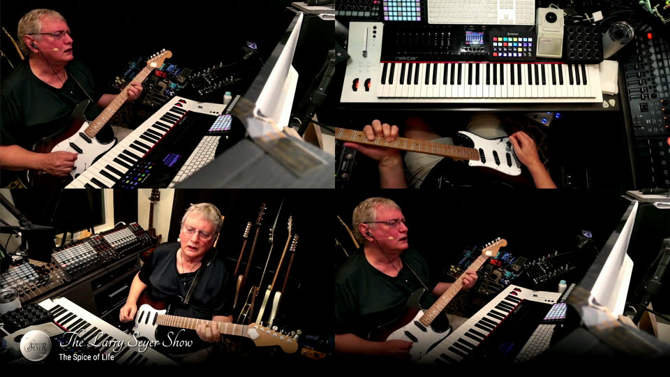

# Larry Seyer Video Effects for Reaper

Video effects for REAPER's Video Processor, with a control panel: color grading with DaVinci Resolve-style
wheels and curves, titles and lower thirds, tutorial callouts and zooms, transitions that run on crossfades,
picture-in-picture, borders and shadows, film and music-video looks, and multicam editing from a multiview
recording. 40 effects in all.



Every effect is an ordinary Video Processor preset, so projects render the same on any machine that has the
presets, with or without the panel open.

## Install with ReaPack

1. You need [ReaPack](https://reapack.com) and ReaImGui (*Extensions > ReaPack > Browse packages*, search
   "ReaImGui", install).
2. *Extensions > ReaPack > Import repositories*, paste:
   `https://raw.githubusercontent.com/larryseyer/Reaper/main/index.xml`
3. *Extensions > ReaPack > Browse packages*, find **Larry Seyer Video Effects**, install, apply.
4. Run **Larry Seyer Video Effects** from the Actions list. The panel opens and installs the presets.

## Quick start

- Select an item (that clip) or a track (everything on it), click an effect in the panel's library.
- Hover a control for an explanation; the diamond beside it adds a keyframe at the edit cursor.
- **+ Lower third / + Title / + Callout** add a title item whose name is the text (`|` for a second line);
  its fade handles time the animation.
- Transitions go on a track: overlap two items and the overlap becomes the transition.

## Documentation

- **[Manual](docs/MANUAL.md)** - every effect with a picture, what each control does, and settings to try.
- **[AI reference](docs/AI-REFERENCE.md)** - written for AI agents that build videos in REAPER: preset names,
  control indexes and ranges, the rules that matter, recipes, and a scripting API (`lib/agent.lua`) that takes
  control names instead of numbers. `docs/effects.json` has the same information as data.
- **Claude Code skill** - copy `ai/claude-skill/larry-seyer-video-effects` into `~/.claude/skills/` and Claude knows how to
  use every effect.

## For contributors

Each effect is one file in `effects/` (EEL2 Video Processor code; shared code in `effects/lib/`). Lines starting
`//@ls` describe the effect: category, title, help for each control, examples and tips. They feed the panel and
all documentation, which is generated:

```
lua tools/build_docs.lua .                      # docs/*.md, docs/effects.json, the Claude skill
python3 tools/render_doc_images.py             # docs/images (renders through REAPER)
python3 tests/compile_check.py <effect>        # finds EEL2 compile errors by rendering
python3 tools/build_reapack_index.py           # index.xml for a release (see the script for steps)
```

## License

See [LICENSE](LICENSE).
