# Larry Seyer Video Effects manual

Version 1.1.7 - 43 video effects for REAPER.

Larry Seyer Video Effects turns REAPER's Video Processor into a complete set of video effects: color grading with
lift, gamma and gain wheels, titles and lower thirds, tutorial callouts and zooms, transitions,
picture-in-picture, borders and shadows, looks, and a multicam switcher for cutting between cameras.
Every effect is an ordinary Video Processor preset, so projects render the same on any computer that has
the presets, with or without the control panel open.

## Installing

1. Install [ReaPack](https://reapack.com) if you do not have it.
2. *Extensions > ReaPack > Import repositories*, paste
   `https://raw.githubusercontent.com/larryseyer/larry-seyer-video-effects/main/index.xml`
3. *Extensions > ReaPack > Browse packages*, type **Larry Seyer** in the filter, right-click
   **Larry Seyer Video Effects** and choose *Install*. Also install **ReaImGui** (type *ReaImGui* in the same
   window) if you do not have it; the panel and the Multicam window need it. Click *Apply*, and restart REAPER if
   ReaPack asks you to. Importing the repository in step 2 does not install anything by itself.
4. **Important - run it once after installing:** ReaPack copies the files but cannot add presets by itself. Open
   *Actions > Show action list*, search **Larry Seyer Video Effects** and run it. The panel opens and adds the
   43 **LS** presets to the Video Processor preset list. Until you do this, the presets are not there. If
   ReaImGui is missing, it offers to open ReaPack on it.

Updates arrive through *ReaPack > Synchronize packages*; the panel and the Multicam window bring the presets up to
date the next time they open.

## Using the panel

- Select an **item** to put effects on that clip, or a **track** for everything on the track.
- Click an effect in the library on the left; its controls appear on the right. Hover any control for an
  explanation, double-click it to reset.
- **Keyframes:** the diamond beside a control adds a keyframe at the edit cursor (click again to remove).
  Once a control has keyframes, changing it keys the new value at the edit cursor. *< Key* and *Key >* jump
  between keyframes, *Keyframe all* keys every control. Keyframes are normal REAPER envelopes.
- **Frame pad:** effects with positions or areas show a frame you drag on (points move, areas move and resize
  from the corner square). Watch the result in REAPER's Video window.
- **+ Lower third, + Title, + Callout** add a transparent title item at the edit cursor (or over the time
  selection) carrying that effect. The item name is the text; `|` starts a new line. The item's fade-in and
  fade-out handles set how long it animates on and off.
- **Lock** keeps the panel on the current item or track while you select other things.

Without the panel: add a Video processor to an item or track and choose any **LS ...** entry from its preset list.

## Multicam

Cut a shoot with several cameras the way a live switcher does: play it and press the number of the camera you
want, or click that camera in the Video window.

1. Put each camera on its own track.
2. Click **Multicam** in the panel (or run *Larry Seyer Video Effects - Multicam* from the Actions list). Select
   the camera tracks (2 to 9; top to bottom become cameras 1, 2, 3...) and click **Set up from selected tracks**.
   A *Multicam* track with the **Multicam Switcher** goes in front of them, and each camera track gets a
   **Multicam Camera** effect with its number. With **Line them up by their audio** ticked (the default), every
   camera's clips then move to where their sound matches camera 1's (see *Lining cameras up by audio* below).
3. While the Multicam window is open, the Video window shows **switcher view**: the program large, every camera
   underneath with its track name, and the camera on air outlined in red.
4. Play. Press **1-9**, click a camera button in the window, or click a camera in the Video window. Each switch is
   a cut at that moment. Playing a section again and switching replaces its earlier cuts from your first switch
   to your last, and any cut in the half second before your first switch. **Space** plays and stops.
5. Stopped, a number (or a click) changes the camera of the shot at the edit cursor. **Left/Right arrows** jump
   between cuts, **Delete** removes the cut at the cursor.
6. **Switch with** sets how switches happen: **Cut**, or a **Transition** (cross dissolve, dip to black or white,
   additive, blur or luma dissolve, push, slide in or out, split open, squeeze) with its length in frames. Hold
   **Shift** for the other one on a single switch. *Give it the transition* and *Make it a cut* change the cut at
   the cursor.
7. Close the window: the Video window goes back to the program, which is what renders.

The cuts are points on the Multicam Switcher's **Camera** envelope, so you can also drag, copy or delete them in
the arrange view. Each point carries its cut's transition in its value, just above the camera number (2.0288 is
camera 2 with a 15-frame cross dissolve), so the transition always moves with the cut. Change a cut's camera or
transition in the Multicam window; a whole number typed into a point makes it use the switcher's Transition
controls. Projects cut before version 1.1.7, which kept transitions on separate envelopes, are converted when the
Multicam window opens. Transitions play and render in order; jumping the play cursor into one shows a straight cut.

- **Number keys anywhere in REAPER:** the keys work while the Multicam window has focus. After clicking in the
  Video window, focus is there; to switch from the keyboard then, assign *Larry Seyer Video Effects - Multicam
  camera 1* to *9* to the number keys (*Actions > Show action list*, select one, *Add* a shortcut), and the
  *(Shift)* versions to Shift+number.
- **Color matching:** put color effects on a camera track before its Multicam Camera effect; that effect must
  stay last (the Multicam window moves it back when it opens).
- **Portrait clips** (a phone held upright) show with black bars at the sides, as REAPER shows them on their own.
- **A camera that starts late or stops early** shows black (and *no video* in switcher view) where its track has
  no video.
- **One multiview recording** (four or nine cameras in one picture): put it on the track behind the switcher and
  set the switcher's *Source* to *2x2 multiview* or *3x3 multiview*. **Multiview Camera Select** is the per-item
  alternative.
- Camera audio plays as usual; mute or lower the camera tracks if your mix is on other tracks.

### Lining cameras up by audio

Cameras are rarely started at the same moment. If each one recorded the sound of the performance (its own
microphone, or a feed from the desk), the Multicam window lines them up for you: open **Line up by audio**, choose
the **reference** (camera 1 by default, or any other track with clips, such as a board mix) and click **Line up
the cameras**. Every clip on every camera track moves to where its sound matches the reference, to within a
millisecond; the window lists what moved. **Undo** puts everything back in one step.

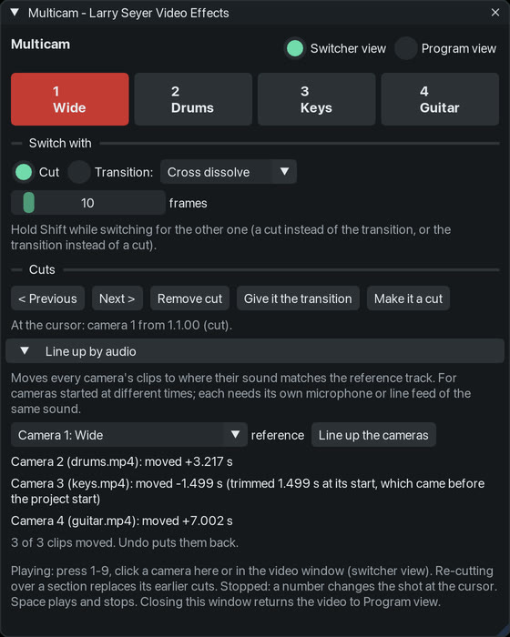

- A camera stopped and started again (several clips on its track) is fine: each clip is lined up on its own.
- A clip that belongs before the start of the project is trimmed at its start instead.
- Clips whose sound does not match (a silent camera, a different song) stay where they are, and the list says so.
  A clip needs about five seconds of sound in common with the reference.
- Cameras' clocks run at slightly different speeds. When a clip drifts more than 10 ms against the reference
  over its length, it is lined up at its middle and the list says how far it drifts.
- The sync uses each clip's audio as it is on the timeline; it does not change the video or the sound.

## Things that work the same everywhere

- **Layers:** *Project Settings > Video > Track order* decides whether the top or the bottom track is in front.
  Effects that place or frame a picture draw the tracks behind them as the background, so put the foreground clip
  on a track in front of it. The panel's **+** buttons put new title tracks on the correct side for either setting.
- **Transitions:** put a transition effect on a track; every crossfade between items on that track becomes the
  transition, as long as the crossfade.
- **Animated entrances** follow the item fades (titles, callouts, picture-in-picture, Zoom to Region,
  Spotlight, Magnifier).
- **Speed:** most effects are light. Effects that process every pixel (Color Grade with hue rotate or vibrance,
  Hue Curves, Isolate Color, Looks, Sharpen, Green Screen, Blend Modes, some transitions) are slower at 4K.
  For smooth playback while editing, lower the preview resolution in the Video window, or bypass them until
  the final render.

## Using Larry Seyer Video Effects with AI

`docs/AI-REFERENCE.md` is a complete reference written for AI agents, with a scripting API (`lib/agent.lua`)
that takes control names instead of numbers. For Claude Code, copy `ai/claude-skill/larry-seyer-video-effects` into
`~/.claude/skills/`; Claude then knows how to use every effect when asked to build or edit a video in REAPER.

## The effects

## Transform

### Border & Shadow

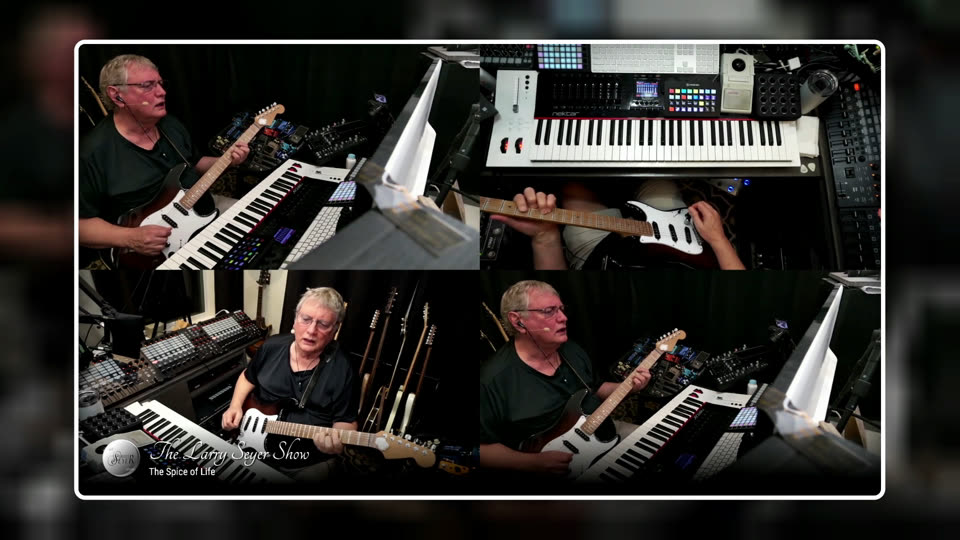

Frames a clip with a border (solid, double, glow or gradient), rounded corners, a drop shadow and soft inner shading, over the tracks behind it, a blurred copy or a color. **Goes on:** item or track. Preset name: `LS Transform: Border & Shadow`.

| Control | What it does | Range (default) |
|---|---|---|
| Picture size | 1 makes picture plus border fill the frame; smaller insets it. | 0.1 to 1 (0.85) |
| Position X | Offset, -1 left to 1 right (half-frame units). | -1 to 1 (0) |
| Position Y | Offset, -1 up to 1 down. | -1 to 1 (0) |
| Corner radius | Corner rounding, fraction of the shorter side. | 0 to 0.5 (0.03) |
| Border style | Border look. | None, Solid, Double line, Glow, Gradient |
| Border width | Border width, fraction of frame height (glow spreads three times wider). | 0 to 0.06 (0.008) |
| Border color | Color picker. |  |
| Second border color | Color picker. |  |
| Border opacity | Border opacity. | 0 to 1 (1) |
| Shadow opacity | Drop shadow strength. | 0 to 1 (0.6) |
| Shadow distance | Shadow offset, fraction of frame height. | 0 to 0.1 (0.015) |
| Shadow angle | Direction the shadow falls in degrees (90 = down). | -180 to 180 (120) |
| Shadow softness | Shadow blur, fraction of frame height. | 0 to 0.15 (0.03) |
| Shadow color | Color picker. |  |
| Inner shading | Darkens the picture toward its edges. | 0 to 1 (0.25) |
| Shading size | How far the inner shading reaches. | 0.005 to 0.3 (0.06) |
| Background | What shows around the framed picture. | Tracks behind, Blurred copy, Solid color, Black |
| Background color | Color picker. |  |

**Try this:**

- *Framed clip over blurred background* - Picture size 0.85, Border style Solid, Border width 0.008, Corner radius 0.03, Background Blurred copy, Shadow opacity 0.6.
- *Mint glow frame* - Picture size 1, Border style Glow, Border width 0.008, Border red 0.24, Border green 0.87, Border blue 0.66.

### Camera Shake

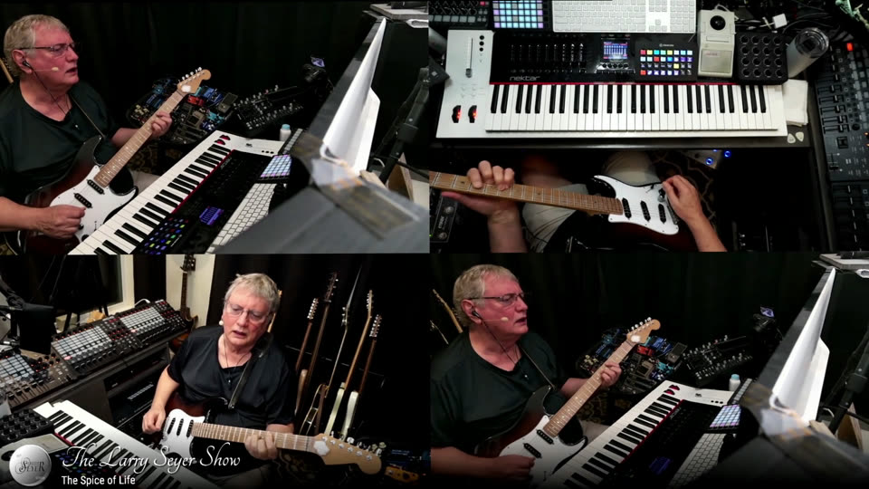

Handheld drift, nervous jitter or an earthquake rumble. Automate the amount to hit specific moments. **Goes on:** item or track. Preset name: `LS Transform: Camera Shake`.

| Control | What it does | Range (default) |
|---|---|---|
| Amount | Movement in frame widths (0.015 gentle, 0.05 violent). | 0 to 0.1 (0.015) |
| Rotation (deg) | Rotation wobble in degrees. | 0 to 10 (1) |
| Speed | Wobbles per second. | 0.05 to 20 (1.5) |
| Style | Smooth handheld drift, nervous jitter, or a mix (earthquake). | Handheld, Jitter, Earthquake |
| Seed | Changes the random pattern. | 0 to 100 (1) |
| Zoom to hide edges | Zooms in slightly so moving edges stay hidden. | off/on (on) |

**Try this:**

- *Handheld feel* - Amount 0.01, Rotation (deg) 0.6, Speed 1, Style Handheld.
- *Impact hit* - Style Earthquake, Amount 0.04. Keyframe Amount from 0.04 down to 0 over half a second.

### Corner Pin

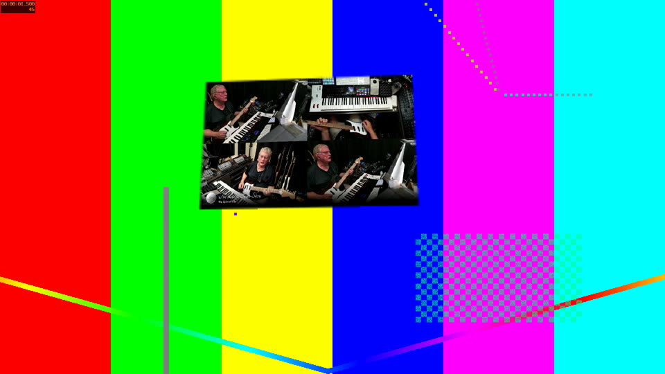

Pins the four corners of this clip anywhere on screen, for putting a screen recording onto a monitor or a sign in the shot. **Goes on:** item or track. Preset name: `LS Transform: Corner Pin`.

| Control | What it does | Range (default) |
|---|---|---|
| Top left X | Corner positions are fractions of the frame (0..1, may go off screen). | -0.5 to 1.5 (0.15) |
| Top left Y |  | -0.5 to 1.5 (0.15) |
| Top right X |  | -0.5 to 1.5 (0.85) |
| Top right Y |  | -0.5 to 1.5 (0.1) |
| Bottom right X |  | -0.5 to 1.5 (0.8) |
| Bottom right Y |  | -0.5 to 1.5 (0.9) |
| Bottom left X |  | -0.5 to 1.5 (0.2) |
| Bottom left Y |  | -0.5 to 1.5 (0.85) |
| Opacity |  | 0 to 1 (1) |

**Try this:**

- *Screen recording on a monitor in the shot* - Top left X 0.31, Top left Y 0.22, Top right X 0.62, Top right Y 0.2, Bottom right X 0.63, Bottom right Y 0.55, Bottom left X 0.3, Bottom left Y 0.56. Put on the screen recording item, on a track in front of the camera shot; move the four corners onto the monitor.

- Drag the four corner points on the panel's frame pad.

### Flip & Mirror

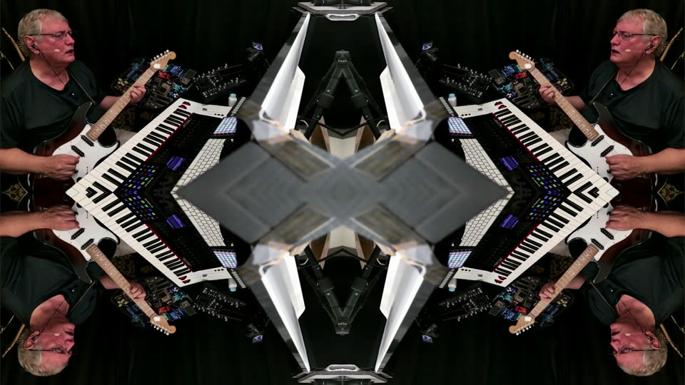

Flips the picture or mirrors one half onto the other, including a four-way kaleidoscope. **Goes on:** item or track. Preset name: `LS Transform: Flip & Mirror`.

| Control | What it does | Range (default) |
|---|---|---|
| Mode | What to flip or mirror. | Off, Flip horizontal, Flip vertical, Rotate 180, Mirror left half, Mirror right half, Mirror top half, Mirror bottom half, Kaleidoscope |
| Mirror line | Moves the mirror line away from the center, -0.5..0.5. | -0.5 to 0.5 (0) |

**Try this:**

- *Kaleidoscope* - Mode Kaleidoscope.

### Multicam Camera

Marks a track as a camera for the Multicam Switcher and gives it its number. The Multicam action adds it to each camera track; keep it last in the track's effects (put color matching before it). **Goes on:** track. Preset name: `LS Transform: Multicam Camera`.

| Control | What it does | Range (default) |
|---|---|---|
| Camera number | This track's camera number in the Multicam Switcher (1-9). | 1 to 9 (1) |

**Try this:**

- *Camera 2* - Camera number 2.

### Multicam Clicks

Lets you click a camera in the video window to cut to it while the Multicam Switcher shows switcher view. Lives in Monitoring FX (never in renders); the Larry Seyer Video Effects - Multicam action adds it while open and removes it when closed. **Goes on:** monitoring fx. Preset name: `LS Transform: Multicam Clicks`.

| Control | What it does | Range (default) |
|---|---|---|
| Hover outline | Outline the camera under the mouse. | off/on (on) |

### Multicam Switcher

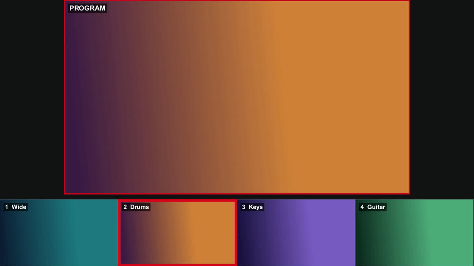

Cuts between cameras like a live switcher. Goes on a Multicam track in front of the camera tracks; its Camera envelope is the cut list and each cut carries its own transition. Switcher view shows the program with every camera underneath and the live one outlined in red. Set it up and cut with the Larry Seyer Video Effects - Multicam action (number keys or clicks in the video window). **Goes on:** track. Preset name: `LS Transform: Multicam Switcher`.

| Control | What it does | Range (default) |
|---|---|---|
| Camera | Camera on air. Its envelope holds the cuts: each point switches to that camera. A cut made in the Multicam window also carries its transition in the point's value, just above the camera number (2.0288 is camera 2 with a 15-frame cross dissolve), so it moves with the point. | 1 to 9 (1) |
| View | Program shows the edit (what renders). Switcher shows the program with all cameras underneath, for cutting; the Multicam action sets it back to Program when you close it. | Program, Switcher |
| Transition | How the switch happens at Camera points with a whole-number value (typed by hand). Cuts made in the Multicam window carry their own transition. | Cut, Cross dissolve, Dip to black, Dip to white, Additive dissolve, Blur dissolve, Luma dissolve, Push, Slide in, Slide out, Split open, Squeeze |
| Transition frames | Length of the transition in frames (for whole-number Camera points). | 1 to 120 (12) |
| Direction | Direction for Push, Slide, Split and Squeeze (for whole-number Camera points). | Left, Right, Up, Down |
| Smoothness | How the transition speeds up and slows down. | Linear, Smooth, Ease in, Ease out |
| Motion blur | Motion blur for Push and Slide. | 0 to 1 (0.5) |
| Source | Camera tracks: each camera on its own track, marked with a Multicam Camera effect. Multiview: one recording with the cameras in a grid, on the track directly behind. | Camera tracks, 2x2 multiview, 3x3 multiview |
| Edge trim | With a multiview recording: cuts this fraction off each cell's edges to hide dividers. | 0 to 0.05 (0.004) |
| Camera names | Show each camera's track name in switcher view. | off/on (on) |

**Try this:**

- *Switcher view while cutting* - View Switcher.
- *2x2 multiview recording* - Source 2x2 multiview.

- Run the Larry Seyer Video Effects - Multicam action: select your camera tracks and click Set up, then play and press 1-9 or click a camera in the video window.
- Edit cuts on the Camera envelope: drag a point to move a cut with its transition. To change a cut's camera or transition, use the Multicam window (stopped, a number changes the shot at the cursor); typing a whole number into a point makes it use the Transition controls.
- Transitions play and render in order; when you jump the play cursor into one, it shows as a straight cut.

### Multiview Camera Select

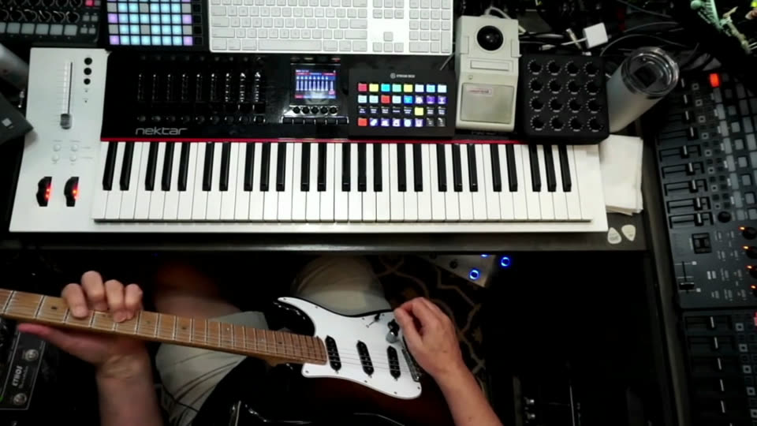

Turns a multiview recording (four cameras in one frame) into a multicam edit: show one camera full screen, two side by side, or one inset over another. Put it on each item and pick the camera, then crossfade items for transitions. **Goes on:** item or track. Preset name: `LS Transform: Multiview Camera Select`.

| Control | What it does | Range (default) |
|---|---|---|
| Camera | Camera to show. 2x2: 1 top-left, 2 top-right, 3 bottom-left, 4 bottom-right. 0 shows the whole multiview. | 0 to 9 (1) |
| Multiview grid | Layout of the multiview recording. | 2x2 (4 cameras), 3x3 (9 cameras), Side by side (2), Stacked (2) |
| Punch in | Punch in on the chosen camera. | 1 to 3 (1) |
| Pan X | With punch-in: which part of that camera shows, -1 left to 1 right. | -1 to 1 (0) |
| Pan Y | -1 top to 1 bottom. | -1 to 1 (0) |
| Edge trim | Cuts this fraction off each camera's edges to hide multiview dividers. | 0 to 0.05 (0.004) |
| Sharpen | Restores crispness when a quarter is enlarged (costs speed at 4K). | 0 to 1 (0) |
| Layout | One camera, two side by side, or one inset over another. | Single camera, Two-up, Picture-in-picture |
| Second camera | Second camera for Two-up and Picture-in-picture. | 1 to 9 (2) |
| Two-up split | Where the two-up divides the frame. | 0.2 to 0.8 (0.5) |
| Gap | Gap between two-up panels, fraction of frame width. | 0 to 0.05 (0.006) |
| Inset corner | Corner for the inset camera. | Top left, Top right, Bottom left, Bottom right |
| Inset size | Inset width, fraction of frame width. | 0.1 to 0.6 (0.32) |

**Try this:**

- *Camera 2 full screen* - Camera 2.
- *Guitar close-up from camera 1* - Camera 1, Punch in 1.8, Pan X 0.4, Pan Y 0.3, Sharpen 0.4.
- *Cameras 1 and 4 side by side* - Layout Two-up, Camera 1, Second camera 4.

- Split the recording at every cut and set the camera on each item.
- Crossfade neighbouring items and put a Transition effect on the track for dissolves or pushes between cameras.

### Pan & Zoom

Slow pan and zoom across a photo, screenshot or shot. Set the start and end framing; the move runs for the duration, counted from the item start (item FX) or from the start time (track FX). **Goes on:** item or track. Preset name: `LS Transform: Pan & Zoom`.

| Control | What it does | Range (default) |
|---|---|---|
| Start zoom | Zoom at the start (1 = whole picture). | 1 to 5 (1) |
| Start X | Start framing: -1 left edge, 1 right edge. | -1 to 1 (0) |
| Start Y | Start framing: -1 top, 1 bottom. | -1 to 1 (0) |
| End zoom | Zoom at the end. | 1 to 5 (1.35) |
| End X | End framing, -1..1. | -1 to 1 (0.3) |
| End Y | End framing, -1..1. | -1 to 1 (-0.2) |
| Duration (s) | Length of the move in seconds; set it to the item length. | 0.1 to 120 (6) |
| Start time (s) | Track FX only: project time in seconds when the move starts. On an item the move starts at the item start. | 0 to 3600 (0) |
| Easing | How the move speeds up and slows down. | Linear, Smooth, Ease in, Ease out |

**Try this:**

- *Slow push in on a photo* - Start zoom 1, End zoom 1.25, End X 0, End Y 0, Duration (s) 8. Put on the photo item; set Duration to the item length.
- *Pan across a wide screenshot* - Start zoom 1.4, Start X -1, Start Y 0, End zoom 1.4, End X 1, End Y 0, Duration (s) 6.

### Picture-in-Picture & Logo

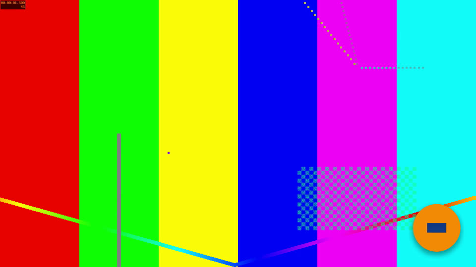

Places this clip, screenshot or logo in a corner or anywhere on screen, with rounded or circular framing, border, shadow and an entrance animated by the item fade handles. **Goes on:** item or track. Preset name: `LS Transform: Picture-in-Picture & Logo`.

| Control | What it does | Range (default) |
|---|---|---|
| Corner | Where the box sits on screen. | Top left, Top, Top right, Left, Center, Right, Bottom left, Bottom, Bottom right |
| Size | Box width as a fraction of frame width. | 0.02 to 1 (0.3) |
| Margin | Gap from the frame edges, fraction of frame height. | 0 to 0.3 (0.04) |
| Nudge X | Fine nudge in frame widths. | -1 to 1 (0) |
| Nudge Y | Fine nudge in frame heights. | -1 to 1 (0) |
| Aspect | Box shape. Source keeps the clip's own shape; Circle shape always uses 1:1. | Source, 16:9, 4:3, 1:1, 9:16, 4:5 |
| Zoom inside | Zoom into the clip inside the box. | 1 to 4 (1) |
| Pan inside X | Which part of the clip shows when zoomed or cut to another shape: -1 left, 1 right. | -1 to 1 (0) |
| Pan inside Y | -1 top, 1 bottom. | -1 to 1 (0) |
| Shape | Rectangle, rounded rectangle or circle. | Rectangle, Rounded, Circle |
| Corner radius | Rounding for the Rounded shape, fraction of the shorter side. | 0 to 0.5 (0.12) |
| Border width | Border width, fraction of frame height (0 = none). | 0 to 0.03 (0.003) |
| Border color | Color picker. |  |
| Shadow opacity | Shadow strength; the shadow follows the shape and any PNG transparency. | 0 to 1 (0.5) |
| Shadow distance |  | 0 to 0.1 (0.008) |
| Shadow angle |  | -180 to 180 (120) |
| Shadow softness |  | 0 to 0.1 (0.02) |
| Opacity |  | 0 to 1 (1) |
| Use image transparency | Keep PNG transparency (logos). Turn off to show the image's transparent areas as black. | off/on (on) |
| Entrance | Entrance animation. It plays during the item fade-in and runs backwards during the fade-out. | None, Fade, Slide in, Pop, Zoom, Rise |
| Animate with | Item fades: the item's fade handles drive the animation. Manual: Manual amount does (0 hidden, 1 shown). | Item fades, Manual |
| Manual amount | Used when Animate with is Manual: 0 hidden, 1 fully shown. Keyframe it for custom timing. | 0 to 1 (1) |

**Try this:**

- *Logo bug, bottom right* - Corner Bottom right, Size 0.12, Shape Rectangle, Border width 0, Shadow opacity 0.4, Entrance Fade, Use image transparency 1. Put on the logo PNG item, on a track in front of the video. Give the item 0.5 s fades.
- *Round webcam bubble* - Corner Bottom left, Size 0.22, Shape Circle, Border width 0.004, Entrance Pop. Put on the webcam item; use Zoom inside and Pan to frame the face.
- *Screenshot card sliding in* - Corner Center, Size 0.6, Shape Rounded, Corner radius 0.04, Entrance Slide in.

- Use this instead of REAPER's stock Image overlay preset.
- If the item's fades already make a crossfade, set Animate with to Manual and keyframe Manual amount.

### Reframe & Letterbox

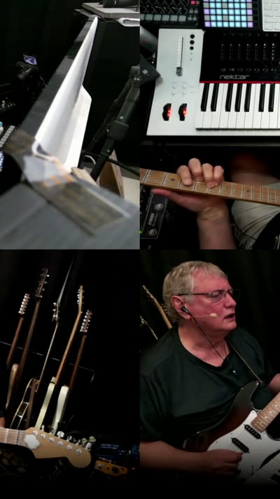

Fits or fills the frame from any source shape, with pan for choosing what stays in view. Use it for vertical short-form video from widescreen footage, blurred-background fills, and cinematic letterbox bars. **Goes on:** item or track. Preset name: `LS Transform: Reframe & Letterbox`.

| Control | What it does | Range (default) |
|---|---|---|
| Mode | Fill crops to cover the frame, Fit shows the whole picture, Stretch distorts to fill. | Fill (crop), Fit (show all), Stretch |
| Pan X | With Fill: which part stays visible, -1 left to 1 right. | -1 to 1 (0) |
| Pan Y | With Fill: -1 top to 1 bottom. | -1 to 1 (0) |
| Zoom | Extra zoom on top of the fit. | 0.25 to 4 (1) |
| Fit background | What fills the empty area in Fit mode. | Black, Blurred copy, Solid color |
| Background color | Color picker. |  |
| Letterbox bars | Cinematic bars drawn over the picture. | None, 2.39:1 Cinemascope, 2:1, 1.85:1, 4:3, 1:1 |
| Bar opacity | Bar darkness. | 0 to 1 (1) |

**Try this:**

- *Vertical Short from 16:9 footage* - Mode Fill (crop), Pan X 0. Set the project video size to 1080x1920 first; keyframe Pan X to follow the action.
- *Fit with blurred background* - Mode Fit (show all), Fit background Blurred copy.
- *Cinemascope bars* - Mode Fill (crop), Letterbox bars 2.39:1 Cinemascope.

### Transform

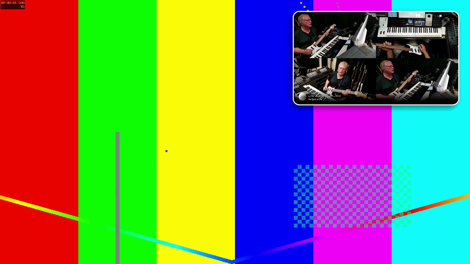

Position, scale, rotate, crop, round corners, border and drop shadow in one pass. Keyframe any control with envelopes. **Goes on:** item or track. Preset name: `LS Transform: Transform`.

| Control | What it does | Range (default) |
|---|---|---|
| Position X | Horizontal offset in frame widths: 0 centered, 0.5 moves it half a frame right. | -1.5 to 1.5 (0) |
| Position Y | Vertical offset in frame heights: positive moves down. | -1.5 to 1.5 (0) |
| Scale | Size relative to the whole picture fitting the frame: 1 fits, 0.5 is half size. | 0 to 5 (1) |
| Stretch X | Extra horizontal stretch (1 = none). | 0.1 to 4 (1) |
| Stretch Y | Extra vertical stretch (1 = none). | 0.1 to 4 (1) |
| Rotation | Rotation in degrees, clockwise. | -720 to 720 (0) |
| Anchor X | Pivot for rotate and scale: -1 left edge, 0 center, 1 right edge of the picture. | -1 to 1 (0) |
| Anchor Y | Pivot for rotate and scale: -1 top edge, 0 center, 1 bottom edge of the picture. | -1 to 1 (0) |
| Crop left | Fraction of the picture cut off the left. Cropping does not re-center the picture. | 0 to 0.95 (0) |
| Crop right | Fraction cut off the right. | 0 to 0.95 (0) |
| Crop top | Fraction cut off the top. | 0 to 0.95 (0) |
| Crop bottom | Fraction cut off the bottom. | 0 to 0.95 (0) |
| Opacity | 0 invisible, 1 solid. | 0 to 1 (1) |
| Flip horizontal |  | off/on (off) |
| Flip vertical |  | off/on (off) |
| Corner radius | Corner rounding as a fraction of the shorter side; 0.5 makes a pill or circle. | 0 to 0.5 (0) |
| Border width | Border width as a fraction of frame height (0.005 is a thin line at any resolution). | 0 to 0.05 (0) |
| Border color | Color picker. |  |
| Shadow opacity | Drop shadow strength (0 = off). | 0 to 1 (0) |
| Shadow distance | Shadow offset, fraction of frame height. | 0 to 0.1 (0.012) |
| Shadow angle | Direction the shadow falls in degrees: 90 straight down, 135 down-left, 45 down-right. | -180 to 180 (135) |
| Shadow softness | Blur of the shadow edge, fraction of frame height. | 0 to 0.1 (0.02) |
| Background | What shows around the picture when it is smaller than the frame. | Tracks behind, Black, Blurred copy, Solid color |
| Background color | Color picker. |  |

**Try this:**

- *Picture-in-picture, top right* - Scale 0.35, Position X 0.3, Position Y -0.28, Corner radius 0.06, Border width 0.004, Shadow opacity 0.6. Put on the inset clip's item, on a track in front of the main video.
- *Tilted card* - Scale 0.6, Rotation -6, Corner radius 0.05, Border width 0.006, Shadow opacity 0.7.
- *Animated zoom-out* - Scale 1.5. Keyframe Scale at 1.5 at the item start and 1 two seconds later.

- On an item it changes only that clip; on a track it changes everything on the track.
- For moves, keyframe Position, Scale and Rotation; the keyframes are ordinary REAPER envelopes.

### Zoom to Region

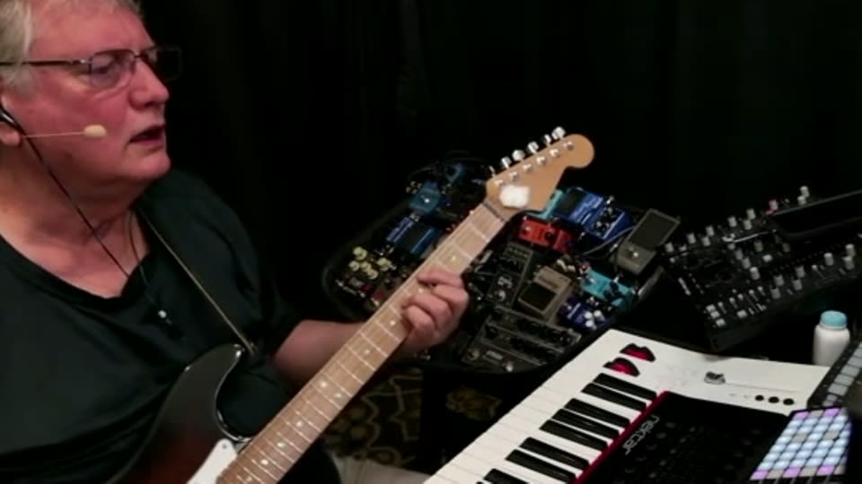

Smoothly zooms into a chosen rectangle, ideal for showing a control in a screen recording. Drag the item fade-in and fade-out to set how long the zoom in and out take, or automate the amount. **Goes on:** item or track. Preset name: `LS Transform: Zoom to Region`.

| Control | What it does | Range (default) |
|---|---|---|
| Region left | Left edge of the zoom region, fraction of the picture width. | 0 to 1 (0.3) |
| Region top | Top edge, fraction of picture height. | 0 to 1 (0.3) |
| Region width | Region width, fraction of picture width. | 0.02 to 1 (0.4) |
| Region height | Region height, fraction of picture height. | 0.02 to 1 (0.4) |
| Animate with | Item fades: zooms in over the fade-in and out over the fade-out. Manual: Manual amount controls it. | Item fades, Manual |
| Manual amount | Manual mode: 0 whole picture, 1 zoomed into the region. | 0 to 1 (1) |
| Easing |  | Linear, Smooth, Ease in, Ease out |
| Show region outline | Draws the region outline while you set it up. Turn it off before rendering. | off/on (off) |

**Try this:**

- *Zoom into a control* - Region left 0.05, Region top 0.1, Region width 0.3, Region height 0.2, Animate with Item fades. Split the screen recording so one item covers the zoom; its fade-in is the zoom-in time, its fade-out the zoom-out time.

- The region is grown to the frame shape so the picture never stretches.
- If the item's fades already make a crossfade, set Animate with to Manual and keyframe Manual amount.
- The region grows around its center to the frame shape. A tall strip (such as the whole right half) grows back to the full frame and does not zoom; for 2x on the right half use left 0.5, top 0.25, width 0.5, height 0.5.

## Color

### Color Grade

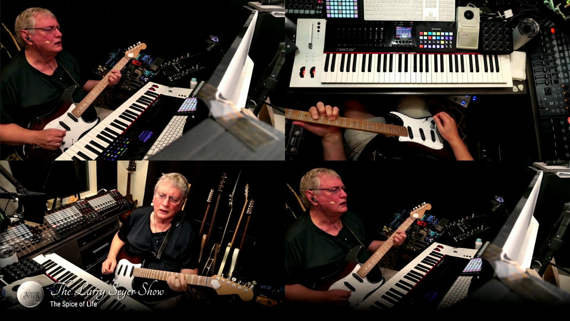

Primary color grading: lift, gamma, gain and offset wheels, temperature and tint, contrast with pivot, saturation, vibrance, exposure, shadows and highlights, with a before/after split. **Goes on:** item or track. Preset name: `LS Color: Color Grade`.

| Control | What it does | Range (default) |
|---|---|---|
| Lift | Lift wheel: color of the shadows. The wheel's red, green and blue values are offsets; pushing toward one color raises it and lowers the others. | -0.5 to 0.5 each |
| Lift master | Raises (positive) or lowers the black level. | -0.5 to 0.5 (0) |
| Gamma | Gamma wheel: color of the midtones. | -1 to 1 each |
| Gamma master | Brightens (positive) or darkens the midtones. | -1 to 1 (0) |
| Gain | Gain wheel: color of the highlights. | -0.5 to 0.5 each |
| Gain master | Overall brightness multiplier (1 = unchanged). | 0 to 2 (1) |
| Offset | Offset wheel: shifts all tones equally. | -0.2 to 0.2 each |
| Offset master | Shifts everything brighter or darker. | -0.2 to 0.2 (0) |
| Contrast | 1 unchanged; above 1 more contrast. | 0 to 2 (1) |
| Pivot | Tone that contrast pivots around (0.435 is video mid-gray). | 0 to 1 (0.435) |
| Saturation | Saturation; 0 is black and white. | 0 to 2 (1) |
| Vibrance | Boosts muted colors more than strong ones, protecting skin tones. | -1 to 1 (0) |
| Temperature | Negative cooler (blue), positive warmer (orange). | -1 to 1 (0) |
| Tint | Negative green, positive magenta. | -1 to 1 (0) |
| Hue rotate | Rotates every color around the color wheel, in degrees. | -180 to 180 (0) |
| Exposure (stops) | Brightness in photographic stops. | -3 to 3 (0) |
| Shadows | Lifts (positive) or deepens dark areas only. | -1 to 1 (0) |
| Highlights | Recovers (negative) or boosts bright areas. | -1 to 1 (0) |
| Mix | Blend with the original (1 = full effect). | 0 to 1 (1) |
| Before/after split | Shows the original on the left half for comparison. Turn off before rendering. | off/on (off) |

**Try this:**

- *Warm stage look* - Temperature 0.25, Saturation 1.1, Contrast 1.1.
- *Teal shadows, warm highlights* - Lift red -0.02, Lift blue 0.04, Gain red 0.06, Gain blue -0.05, Contrast 1.1.
- *Rescue a dark recording* - Exposure (stops) 0.5, Shadows 0.3.

- Temperature, tint, contrast, exposure and the wheels are very fast. Hue rotate and vibrance are slower at 4K.
- Subtle: temperature 0.1-0.2, saturation 1.05-1.15. Strong: temperature 0.4, saturation 1.3.

### Curves

Custom curves: a master curve plus red, green and blue curves, each with seven points you drag in the panel. **Goes on:** item or track. Preset name: `LS Color: Curves`.

| Control | What it does | Range (default) |
|---|---|---|
| Master | Each curve has seven points at input 0%, 17%, 33%, 50%, 67%, 83%, 100%; a point's value is the output (0..1). Equal values mean no change. | 0 to 1 each |
| Red |  | 0 to 1 each |
| Green |  | 0 to 1 each |
| Blue |  | 0 to 1 each |
| Mix | Blend with the original. | 0 to 1 (1) |

**Try this:**

- *Gentle S-curve* - Master 17% 0.12, Master 33% 0.29, Master 67% 0.71, Master 83% 0.88.
- *Faded blacks* - Master 0% 0.08.
- *Warmer highlights* - Red 83% 0.86, Red 100% 1, Blue 83% 0.8, Blue 100% 0.95.

- The channel curves (red, green, blue) are applied first, then the master curve.

### Hue Curves

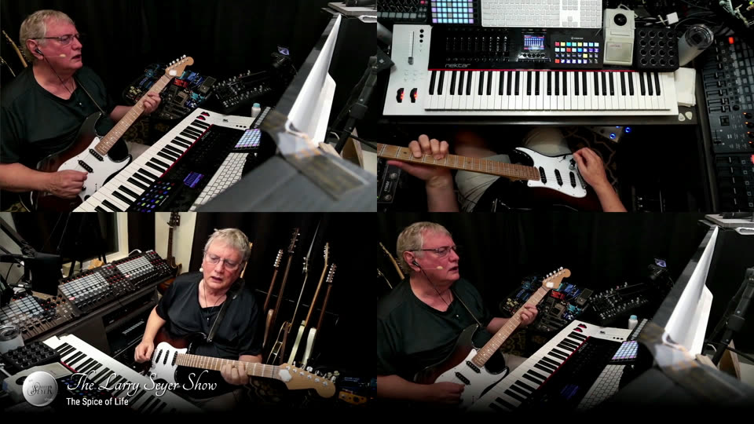

Hue curves: shift the hue, saturation or brightness of each color range separately, plus saturation by brightness. **Goes on:** item or track. Preset name: `LS Color: Hue Curves`.

| Control | What it does | Range (default) |
|---|---|---|
| Hue vs Hue shift | Hue shift in degrees for each color range: index 0 red, 1 yellow, 2 green, 3 cyan, 4 blue, 5 magenta. | -60 to 60 each |
| Hue vs Saturation | Saturation multiplier per color range (same order; 1 unchanged). | 0 to 2 each |
| Hue vs Brightness | Brightness offset per color range (same order). | -0.3 to 0.3 each |
| Shadow saturation | Saturation of dark areas. | 0 to 2 (1) |
| Midtone saturation | Saturation of midtones. | 0 to 2 (1) |
| Highlight saturation | Saturation of bright areas. | 0 to 2 (1) |
| Mix | Blend with the original. | 0 to 1 (1) |

**Try this:**

- *Calm down greens* - Green saturation 0.4.
- *Push oranges toward red* - Yellow hue shift -10.
- *Desaturate the shadows* - Shadow saturation 0.4.

### Isolate Color

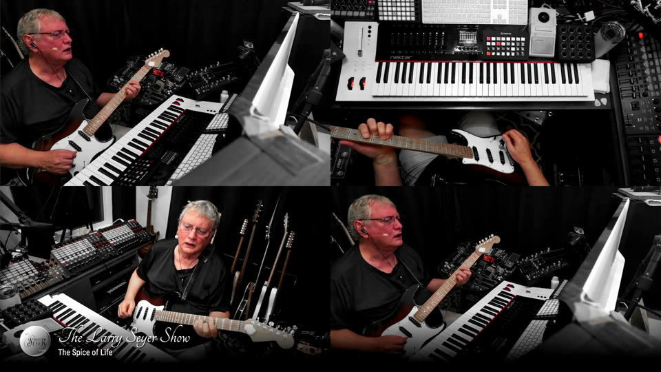

Picks one color range and changes it on its own, or keeps it while the rest of the picture goes black and white for a color-pop look. **Goes on:** item or track. Preset name: `LS Color: Isolate Color`.

| Control | What it does | Range (default) |
|---|---|---|
| Hue | Color to select in degrees: 0 red, 30 orange, 60 yellow, 120 green, 180 cyan, 240 blue, 300 magenta. | 0 to 360 (0) |
| Hue width | How wide a range of hues counts as selected. | 2 to 180 (30) |
| Softness | Softness of the selection edge in degrees. | 0 to 90 (20) |
| Min saturation | Ignore pale colors below this saturation. | 0 to 1 (0.2) |
| Min brightness | Ignore pixels darker than this. | 0 to 1 (0) |
| Max brightness | Ignore pixels brighter than this. | 0 to 1 (1) |
| Inside hue shift | Hue shift for the selected color. | -180 to 180 (0) |
| Inside saturation | Saturation of the selected color. | 0 to 2 (1.2) |
| Inside brightness | Brightness change for the selected color. | -0.5 to 0.5 (0) |
| Outside saturation | Saturation of everything else: 0 makes it black and white (color pop). | 0 to 2 (0) |
| Outside brightness | Brightness change for everything else. | -0.5 to 0.5 (0) |
| Invert selection | Swap selected and unselected. | off/on (off) |
| Show selection | Shows the selection in white. Turn off before rendering. | off/on (off) |
| Mix | Blend with the original. | 0 to 1 (1) |

**Try this:**

- *Color pop: keep only reds* - Hue 0, Hue width 30, Outside saturation 0.
- *Turn a red guitar blue* - Hue 0, Hue width 40, Inside hue shift -120, Outside saturation 1.

- Turn on Show selection while adjusting Hue, Hue width and Min saturation.

### Looks

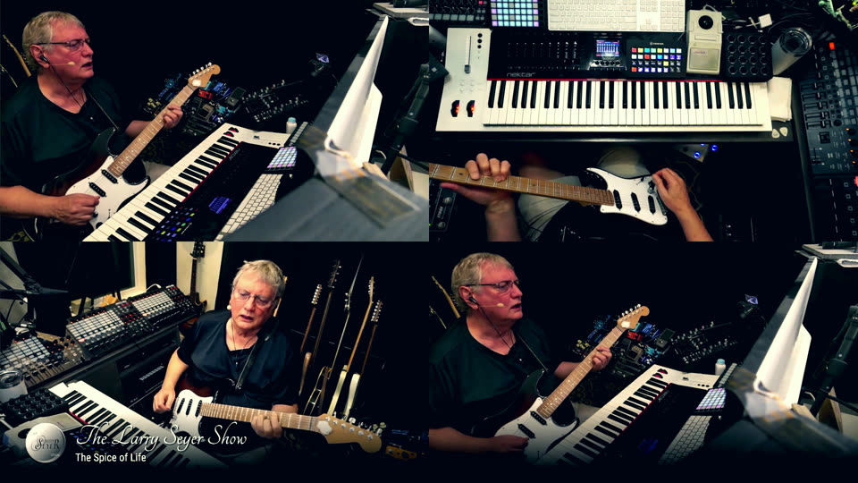

One-knob film and music-video looks: black and white, sepia, teal and orange, warm film, cool night, bleach bypass, faded vintage, cross process, punch, golden hour, noir and duotone. **Goes on:** item or track. Preset name: `LS Color: Looks`.

| Control | What it does | Range (default) |
|---|---|---|
| Look | The look. | Black & White, Sepia, Teal & Orange, Warm Film, Cool Night, Bleach Bypass, Faded Vintage, Cross Process, Punch, Golden Hour, Noir, Duotone |
| Amount | Blend with the original. | 0 to 1 (1) |
| Contrast | Contrast multiplier for the look. | 0 to 2 (1) |
| B&W red weight | Black and white mix: how much red contributes (used by Black & White, Sepia and Noir). | -1 to 2 (0.3) |
| B&W green weight | How much green contributes. | -1 to 2 (0.59) |
| B&W blue weight | How much blue contributes. | -1 to 2 (0.11) |
| Duotone shadows | Color picker. |  |
| Duotone highlights | Color picker. |  |

**Try this:**

- *Teal and orange* - Look Teal & Orange.
- *Black and white* - Look Black & White.
- *Duotone in brand colors* - Look Duotone, Duotone shadow red 0.05, Duotone shadow green 0.1, Duotone shadow blue 0.12, Duotone highlight red 0.24, Duotone highlight green 0.87, Duotone highlight blue 0.66.

### Vignette

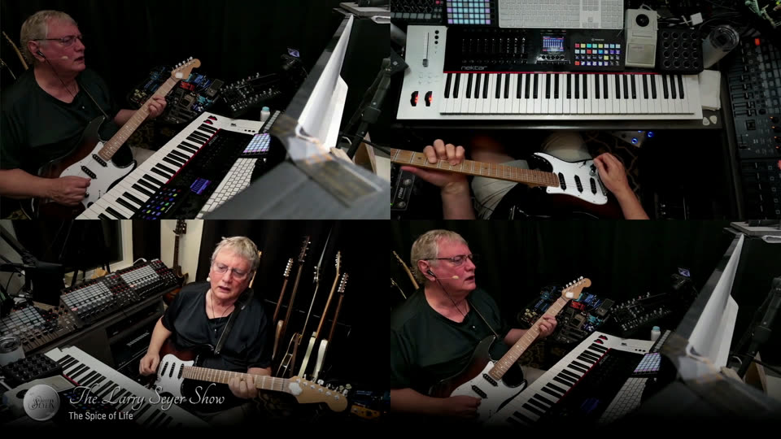

Darkens (or tints) the edges of the frame to pull the eye to the center, with adjustable size, softness, shape and center. **Goes on:** item or track. Preset name: `LS Color: Vignette`.

| Control | What it does | Range (default) |
|---|---|---|
| Amount | Strength at the edges. | 0 to 1 (0.5) |
| Size | Where the darkening is complete; 1 reaches the edges. | 0.1 to 2 (1) |
| Softness | Width of the transition. | 0.01 to 1 (0.7) |
| Roundness | 0 follows the frame shape, 1 is circular. | 0 to 1 (0.5) |
| Center X | Center, -1 left to 1 right. | -1 to 1 (0) |
| Center Y | Center, -1 top to 1 bottom. | -1 to 1 (0) |
| Color | Color picker. |  |

**Try this:**

- *Subtle* - Amount 0.35.
- *White dreamy edges* - Color red 1, Color green 1, Color blue 1, Amount 0.5.

## Look

### Beat Pulse

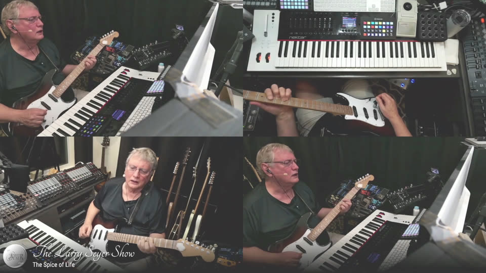

Punches the picture in time with the music using the project tempo: zoom kicks, light flashes, color split and shake on every beat, half beat or bar. **Goes on:** item or track. Preset name: `LS Look: Beat Pulse`.

| Control | What it does | Range (default) |
|---|---|---|
| Pulse on | How often it pulses, using the project tempo. | Every bar, Every 2 beats, Every beat, Every 1/2 beat, Every 1/4 beat |
| Decay | How fast each pulse fades, as a fraction of the interval. | 0.02 to 1 (0.35) |
| Offset (beats) | Moves pulses earlier or later, in beats. | -0.5 to 0.5 (0) |
| Zoom kick | Zoom kick size. | 0 to 0.3 (0.05) |
| Flash | Light flash strength. | 0 to 1 (0.25) |
| Color split | Color split on the hit. | 0 to 1 (0) |
| Shake | Shake on the hit. | 0 to 1 (0) |
| Flash color | Color picker. |  |

**Try this:**

- *Kick on every beat* - Pulse on Every beat, Zoom kick 0.05, Flash 0.2.
- *Bar accents* - Pulse on Every bar, Zoom kick 0.1, Flash 0.5, Color split 0.5.

- Uses the project tempo and time signature: set them to match the song.

### Echo Trails

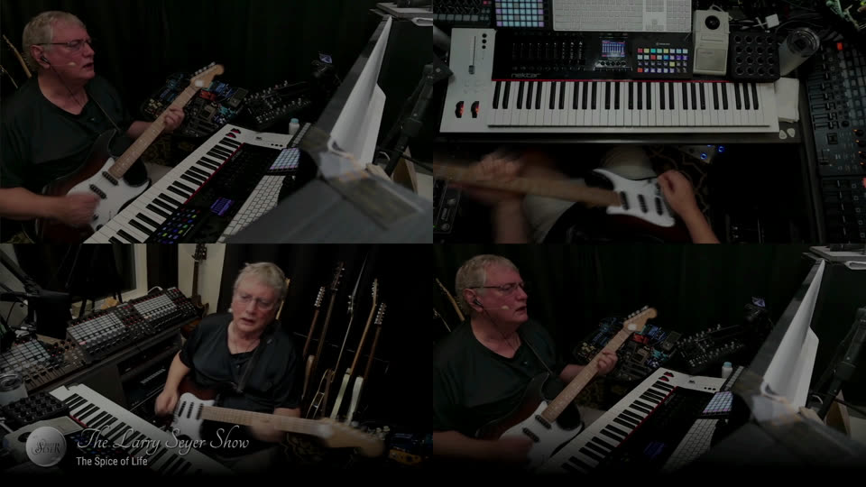

Moving subjects leave fading echoes behind them, with optional zoom or spin drift for psychedelic tunnels. **Goes on:** item or track. Preset name: `LS Look: Echo Trails`.

| Control | What it does | Range (default) |
|---|---|---|
| Trail length | Trail length (0 none, 0.95 very long). | 0 to 0.98 (0.8) |
| Mode | Blend smears; Additive glow brightens overlapping trails. | Blend, Additive glow |
| Zoom drift | Trails zoom in or out over time. | -0.05 to 0.05 (0) |
| Spin drift | Trails rotate over time, degrees per frame. | -5 to 5 (0) |

**Try this:**

- *Dreamy echoes* - Trail length 0.85.
- *Psychedelic tunnel* - Trail length 0.9, Mode Additive glow, Zoom drift 0.01, Spin drift 1.

### Film Look

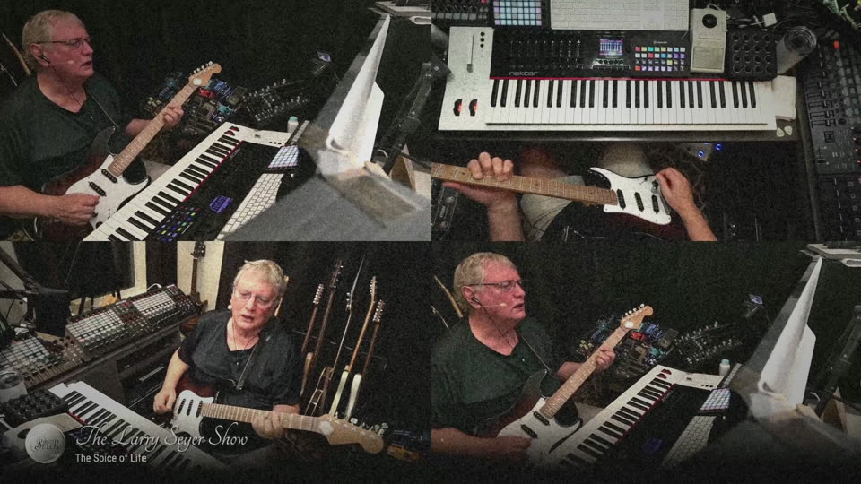

Film grain, gate weave, flicker, dust and scratches, faded blacks, warmth, vignette and optional widescreen bars. **Goes on:** item or track. Preset name: `LS Look: Film Look`.

| Control | What it does | Range (default) |
|---|---|---|
| Grain | Grain strength. | 0 to 1 (0.25) |
| Grain size | Grain size in pixels at 1080p. | 1 to 4 (1.5) |
| Gate weave | Frame wobble like a film projector. | 0 to 1 (0.3) |
| Flicker | Brightness flicker. | 0 to 1 (0.2) |
| Dust & scratches | Dust specks and occasional scratches. | 0 to 1 (0.3) |
| Faded blacks | Lifts black to this level. | 0 to 0.4 (0.08) |
| Warmth | Negative cooler, positive warmer. | -1 to 1 (0.2) |
| Vignette | Edge darkening. | 0 to 1 (0.35) |
| Bars | Widescreen bars. | None, 2.39:1, 1.85:1 |

**Try this:**

- *Vintage film* - Grain 0.35, Dust & scratches 0.5, Faded blacks 0.12, Warmth 0.4.
- *Clean cinematic* - Grain 0.15, Gate weave 0, Flicker 0, Dust & scratches 0, Bars 2.39:1.

### Glitch

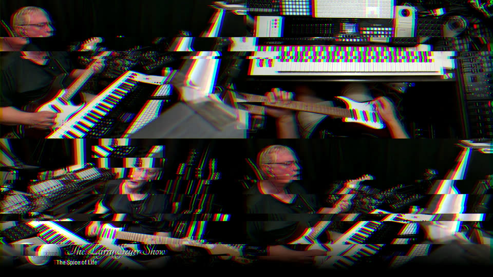

Digital breakup: torn slices, displaced blocks and color splitting. Automate the amount for hits, or lock bursts to the beat. **Goes on:** item or track. Preset name: `LS Look: Glitch`.

| Control | What it does | Range (default) |
|---|---|---|
| Amount | Overall strength; keyframe it for hits. | 0 to 1 (0.5) |
| Slice tearing | Torn horizontal slices. | 0 to 1 (0.6) |
| Block displacement | Displaced rectangles. | 0 to 1 (0.5) |
| Color split | Color channel splitting. | 0 to 1 (0.6) |
| Changes per second | How often the glitch pattern changes per second. | 1 to 30 (12) |
| Burst on each beat | Bursts on every beat of the project tempo. | off/on (off) |
| Seed | Changes the random pattern. | 0 to 100 (1) |

**Try this:**

- *Glitch on the beat* - Amount 0.7, Burst on each beat 1. Set the project tempo to the song first.

### Glow & Bloom

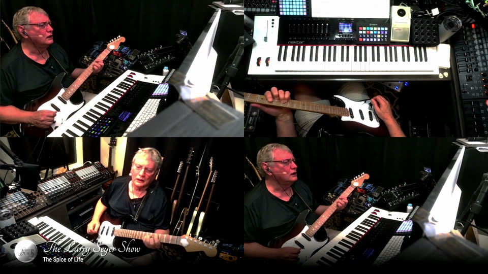

Bright parts bloom into a soft glow, or the whole image gets a dreamy diffusion like a mist filter. **Goes on:** item or track. Preset name: `LS Look: Glow & Bloom`.

| Control | What it does | Range (default) |
|---|---|---|
| Mode | Bloom glows only bright areas; Soft diffusion blends a soft copy over everything (mist filter). | Bloom, Soft diffusion |
| Intensity | Glow strength. | 0 to 2 (0.6) |
| Threshold | Bloom: only parts brighter than this glow. | 0 to 1 (0.65) |
| Size | Glow size. | 0 to 1 (0.5) |
| Tint | Color picker. |  |

**Try this:**

- *Stage light bloom* - Mode Bloom, Intensity 0.8, Threshold 0.6.
- *Mist filter* - Mode Soft diffusion, Intensity 0.6.

### Sharpen & Soften

Crisps up soft or upscaled footage, or softens it for a gentler, diffused look. Positive amounts sharpen, negative amounts soften. **Goes on:** item or track. Preset name: `LS Look: Sharpen & Soften`.

| Control | What it does | Range (default) |
|---|---|---|
| Amount | Positive sharpens, negative softens. | -1 to 2 (0.5) |
| Radius | Size of the detail affected (1 fine to 4 coarse). | 1 to 4 (1) |
| Threshold | Ignores differences below this so noise is not sharpened. | 0 to 0.2 (0.02) |

**Try this:**

- *Crisp up upscaled footage* - Amount 0.8, Radius 1.
- *Soft dreamy* - Amount -0.6, Radius 3.

### VHS & Retro TV

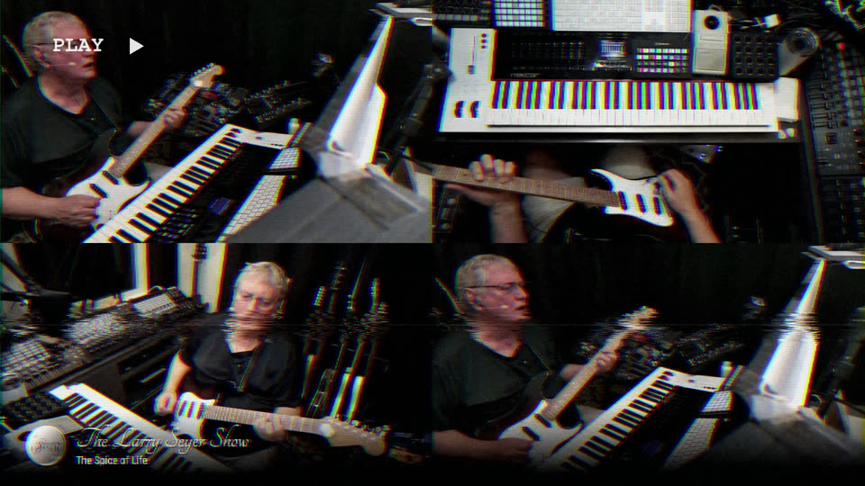

Worn videotape: color bleed, soft picture, scanlines, noise, rolling tracking glitches and an optional PLAY label. **Goes on:** item or track. Preset name: `LS Look: VHS & Retro TV`.

| Control | What it does | Range (default) |
|---|---|---|
| Color bleed | Color fringing. | 0 to 1 (0.5) |
| Softness | Horizontal smear like tape. | 0 to 1 (0.5) |
| Scanlines | Scanline darkness. | 0 to 1 (0.3) |
| Noise | Noise. | 0 to 1 (0.25) |
| Tracking | Rolling tracking glitch band. | 0 to 1 (0.4) |
| Washed out | Washed-out color. | 0 to 1 (0.25) |
| PLAY label | Shows a PLAY label in the corner. | off/on (on) |

**Try this:**

- *Home video flashback* - Color bleed 0.6, Tracking 0.5, PLAY label 1.

### Zoom & Motion Blur

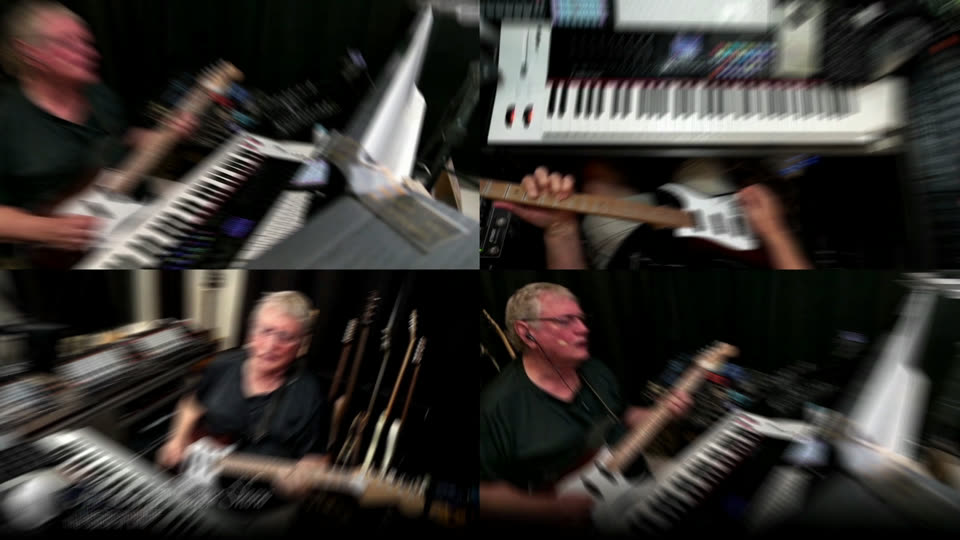

Radial zoom blur bursting from a point, or directional blur that streaks the picture at any angle. **Goes on:** item or track. Preset name: `LS Look: Zoom & Motion Blur`.

| Control | What it does | Range (default) |
|---|---|---|
| Mode | Zoom blurs outward from a point; Directional streaks along an angle. | Zoom, Directional |
| Amount | Blur strength. | 0 to 1 (0.3) |
| Center X | Zoom center, -1 left to 1 right. | -1 to 1 (0) |
| Center Y | Zoom center, -1 top to 1 bottom. | -1 to 1 (0) |
| Angle | Directional angle in degrees. | -180 to 180 (0) |
| Quality | More samples look smoother but are slower. | 4 to 32 (16) |

**Try this:**

- *Burst from center* - Mode Zoom, Amount 0.5.

## Transition

### Dissolve & Dip

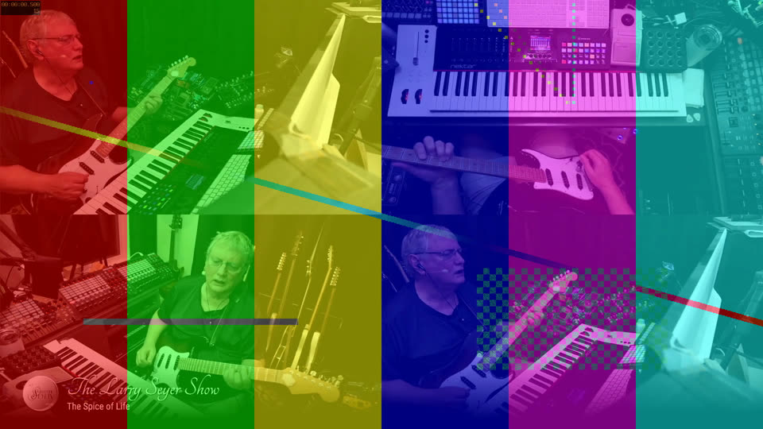

Put on a track: every crossfade between items on that track becomes this transition, lasting as long as the crossfade. Cross dissolve, dip to black, white or a color, additive, blur and luma dissolves. **Goes on:** track. Preset name: `LS Transition: Dissolve & Dip`.

| Control | What it does | Range (default) |
|---|---|---|
| Style | Kind of dissolve. | Cross dissolve, Dip to black, Dip to white, Dip to color, Additive dissolve, Blur dissolve, Luma dissolve |
| Smoothness | How the transition speeds up and slows down. | Linear, Smooth, Ease in, Ease out |
| Dip color | Color picker. |  |
| Source | Item crossfades: runs on every crossfade between items on this track. Manual: blends this track into the next track behind it using Manual progress. | Item crossfades, Manual (this track to the one behind) |
| Manual progress | Manual mode: 0 shows this track, 1 the track behind. Keyframe 0 to 1 over the transition. | 0 to 1 (0) |
| Reverse | Swap outgoing and incoming (use if a direction comes out backwards). | off/on (off) |

**Try this:**

- *Cross dissolve* - Style Cross dissolve.
- *Dip to black* - Style Dip to black.

- Put this on the track. Overlap two items on that track (a crossfade); the transition lasts as long as the overlap.
- One instance handles every crossfade on the track. Use separate tracks for different transition styles.

### Flash, Glitch & Light Leak

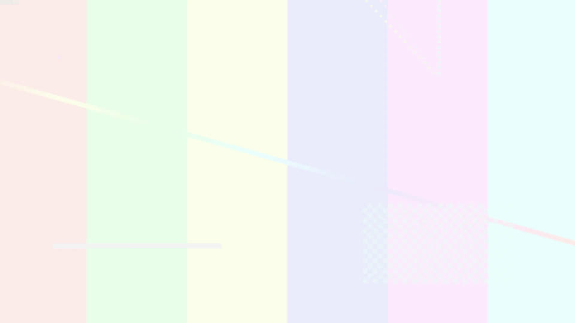

Put on a track: crossfades cut through a white flash, a digital glitch, a warm light leak or a film burn. **Goes on:** track. Preset name: `LS Transition: Flash, Glitch & Light Leak`.

| Control | What it does | Range (default) |
|---|---|---|
| Style | Flash cuts through white; Glitch cuts with digital breakup; Light leak and Film burn add warm light. | Flash, Glitch, Light leak, Film burn |
| Strength | Strength of the flash or light. | 0 to 1 (0.8) |
| Light color | Color picker. |  |
| Source | Item crossfades: runs on every crossfade between items on this track. Manual: blends this track into the next track behind it using Manual progress. | Item crossfades, Manual (this track to the one behind) |
| Manual progress | Manual mode: 0 shows this track, 1 the track behind. Keyframe 0 to 1 over the transition. | 0 to 1 (0) |
| Reverse | Swap outgoing and incoming (use if a direction comes out backwards). | off/on (off) |

**Try this:**

- *White flash* - Style Flash.
- *Light leak* - Style Light leak.

- Put this on the track. Overlap two items on that track (a crossfade); the transition lasts as long as the overlap.
- One instance handles every crossfade on the track. Use separate tracks for different transition styles.

### Push & Slide

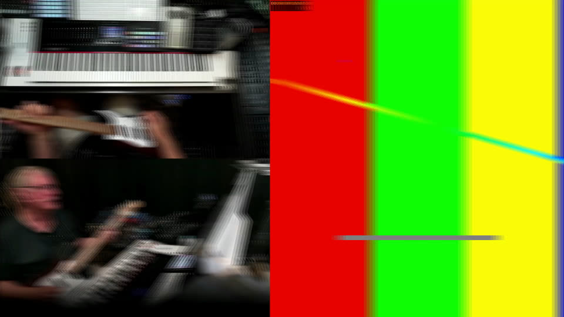

Put on a track: crossfades become a push, slide, reveal, split or squeeze in any direction, with optional motion blur. **Goes on:** track. Preset name: `LS Transition: Push & Slide`.

| Control | What it does | Range (default) |
|---|---|---|
| Style | Push moves both shots; Slide in covers; Slide out uncovers; Split opens like doors; Squeeze compresses. | Push, Slide in, Slide out, Split open, Squeeze |
| Direction | Direction the pictures move; the new shot enters from the opposite side (Left: it comes in from the right). | Left, Right, Up, Down |
| Motion blur | Motion blur during the move. | 0 to 1 (0.5) |
| Smoothness | How the transition speeds up and slows down. | Linear, Smooth, Ease in, Ease out |
| Source | Item crossfades: runs on every crossfade between items on this track. Manual: blends this track into the next track behind it using Manual progress. | Item crossfades, Manual (this track to the one behind) |
| Manual progress | Manual mode: 0 shows this track, 1 the track behind. Keyframe 0 to 1 over the transition. | 0 to 1 (0) |
| Reverse | Swap outgoing and incoming (use if a direction comes out backwards). | off/on (off) |

**Try this:**

- *Push left* - Style Push, Direction Left.
- *Slide up* - Style Slide in, Direction Up.

- Put this on the track. Overlap two items on that track (a crossfade); the transition lasts as long as the overlap.
- One instance handles every crossfade on the track. Use separate tracks for different transition styles.

### Shape Wipe

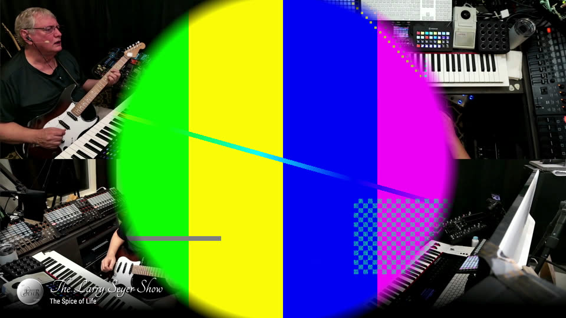

Put on a track: crossfades reveal the next shot through a growing circle, box, diamond, clock sweep, barn doors, angled wipe or blinds, with soft edges and an optional glowing border. **Goes on:** track. Preset name: `LS Transition: Shape Wipe`.

| Control | What it does | Range (default) |
|---|---|---|
| Shape | Shape of the reveal. | Circle, Box, Diamond, Clock, Barn doors (vertical), Barn doors (horizontal), Angled wipe, Blinds |
| Softness | Edge softness. | 0.002 to 0.5 (0.08) |
| Center X | Center, -1 left to 1 right. | -1 to 1 (0) |
| Center Y | Center, -1 top to 1 bottom. | -1 to 1 (0) |
| Angle | Angle for Angled wipe and Blinds, degrees. | -180 to 180 (0) |
| Blinds count | Number of blinds. | 2 to 40 (8) |
| Border | Glowing edge width (0 = none). | 0 to 0.05 (0) |
| Border color | Color picker. |  |
| Shrink instead of grow | Shrink from the edges instead of growing from the center. | off/on (off) |
| Source | Item crossfades: runs on every crossfade between items on this track. Manual: blends this track into the next track behind it using Manual progress. | Item crossfades, Manual (this track to the one behind) |
| Manual progress | Manual mode: 0 shows this track, 1 the track behind. Keyframe 0 to 1 over the transition. | 0 to 1 (0) |
| Reverse | Swap outgoing and incoming (use if a direction comes out backwards). | off/on (off) |

**Try this:**

- *Iris open* - Shape Circle, Softness 0.05.
- *Clock wipe* - Shape Clock.
- *Angled wipe with glowing edge* - Shape Angled wipe, Angle 30, Border 0.01.

- Put this on the track. Overlap two items on that track (a crossfade); the transition lasts as long as the overlap.
- One instance handles every crossfade on the track. Use separate tracks for different transition styles.

### Zoom & Spin

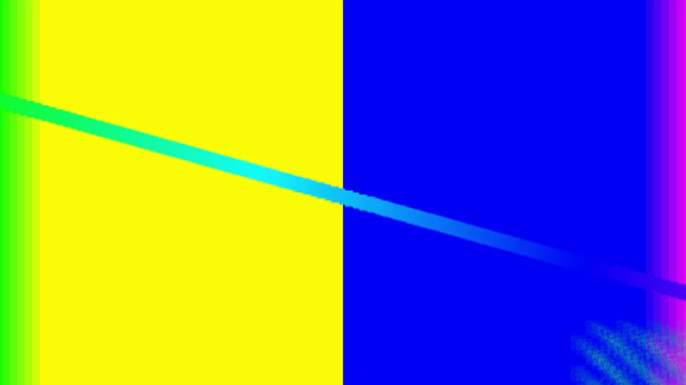

Put on a track: crossfades punch through with a zoom in, zoom out or spinning zoom, blurred at the peak for speed. **Goes on:** track. Preset name: `LS Transition: Zoom & Spin`.

| Control | What it does | Range (default) |
|---|---|---|
| Style | Zoom in through, zoom out, or spinning zoom. | Zoom in, Zoom out, Spin |
| Strength | How far it zooms. | 0 to 1 (0.6) |
| Zoom blur | Zoom blur at the peak. | 0 to 1 (0.6) |
| Source | Item crossfades: runs on every crossfade between items on this track. Manual: blends this track into the next track behind it using Manual progress. | Item crossfades, Manual (this track to the one behind) |
| Manual progress | Manual mode: 0 shows this track, 1 the track behind. Keyframe 0 to 1 over the transition. | 0 to 1 (0) |
| Reverse | Swap outgoing and incoming (use if a direction comes out backwards). | off/on (off) |

**Try this:**

- *Punchy zoom-in* - Style Zoom in, Strength 0.6.

- Put this on the track. Overlap two items on that track (a crossfade); the transition lasts as long as the overlap.
- One instance handles every crossfade on the track. Use separate tracks for different transition styles.

## Title

### Lower Third

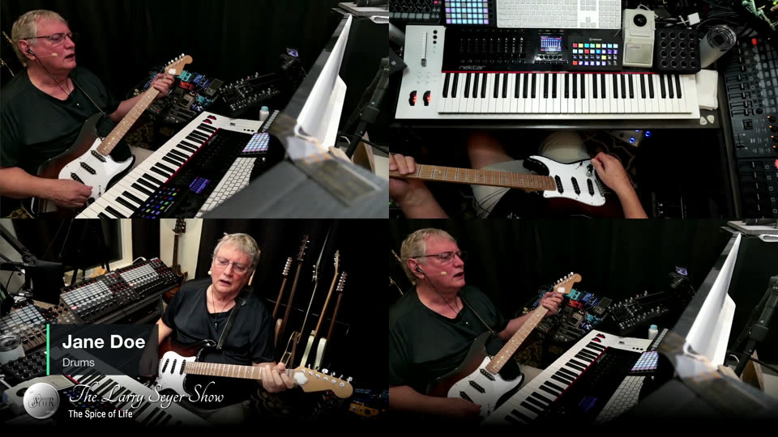

Name and subtitle bar for the lower part of the screen. Name the item "Name | Subtitle". Drag the item fade-in and fade-out to set how long it animates on and off. **Goes on:** item (title item). Preset name: `LS Title: Lower Third`.

| Control | What it does | Range (default) |
|---|---|---|
| Style | Look of the bar. | Bar with accent, Pill, Minimal line, Accent block |
| Align | Left, center or right. | Left, Center, Right |
| Side margin | Distance from the side, fraction of frame width. | 0 to 0.4 (0.06) |
| Height on screen | Vertical center of the bar, fraction of frame height (0.8 is low on screen). | 0 to 1 (0.8) |
| Text size | Name text height, fraction of frame height. | 0.015 to 0.15 (0.05) |
| Subtitle size | Subtitle size relative to the name. | 0.3 to 1 (0.6) |
| Bar | Color picker. |  |
| Bar opacity | Bar opacity. | 0 to 1 (0.85) |
| Accent | Color picker. |  |
| Text | Color picker. |  |
| Font | Font. | Helvetica Neue, Avenir Next, Futura, Georgia, Gill Sans, Menlo, Impact |
| Bold name | Bold name. | off/on (on) |
| Animation | Animation; plays over the item fade-in and reverses over the fade-out. | Slide, Wipe, Fade, Pop |
| Animate with | Item fades or Manual amount. | Item fades, Manual |
| Manual amount | Manual mode: 0 hidden, 1 shown. | 0 to 1 (1) |

**Try this:**

- *Guest name* - Style Bar with accent, Align Left. Item name: "Jane Doe | Drums". Item fades 0.5 s.
- *Centered pill* - Style Pill, Align Center, Font Avenir Next.

- Use the panel's + Lower third button, or put it on a transparent title item. The text is the item name; | starts the subtitle.
- If the item's fades already make a crossfade, set Animate with to Manual and keyframe Manual amount.

### Scrolling Credits

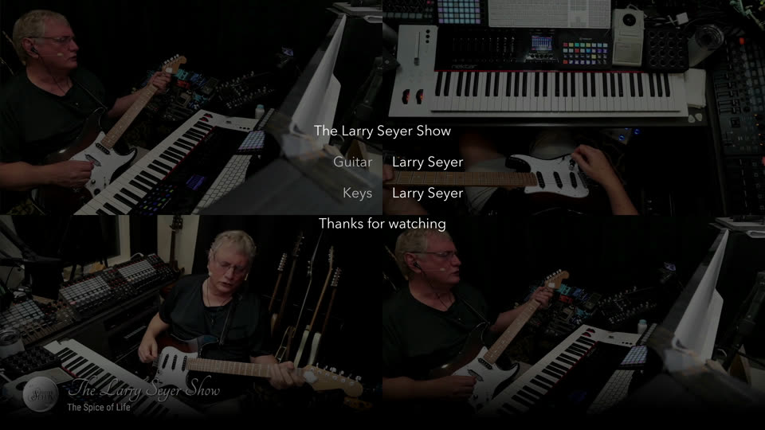

Rolling end credits or a sideways news-style crawl. Name the item with lines separated by "|"; a line like "Drums: Larry Seyer" becomes two columns. Set the duration to the item length. **Goes on:** item (title item). Preset name: `LS Title: Scrolling Credits`.

| Control | What it does | Range (default) |
|---|---|---|
| Mode | Roll up the screen, or crawl sideways along the bottom. | Roll up, Crawl left |
| Duration (s) | Seconds for the whole roll; set it to the item length. | 1 to 600 (10) |
| Text size | Text height, fraction of frame height. | 0.015 to 0.15 (0.045) |
| Line spacing | Line spacing. | 1 to 3 (1.6) |
| Font | Font. | Helvetica Neue, Avenir Next, Futura, Georgia, Gill Sans, Menlo, Impact |
| Text | Color picker. |  |
| Role text | Color picker. |  |
| Backdrop | Darkening or color behind the text. | None, Dim picture, Solid color |
| Backdrop color | Color picker. |  |
| Backdrop opacity | Backdrop opacity. | 0 to 1 (0.6) |

**Try this:**

- *End credits* - Mode Roll up, Duration (s) 12. Item name: "The Larry Seyer Show | Guitar: Larry Seyer | Keys: Larry Seyer | Thanks for watching".

- Separate lines with |. A line with a colon, like "Drums: Larry", becomes two columns.
- The roll starts with the text just below the frame and ends with it just above. Allow about 1.5 s per line. Item fades have no effect.

### Title & Subtitle

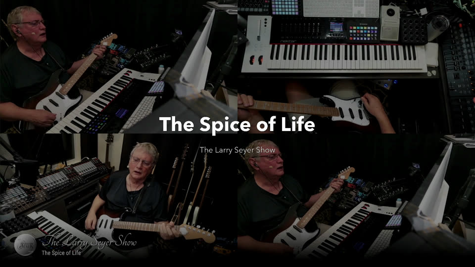

Large centered title with an optional subtitle and backdrop. Name the item "Title | Subtitle". Item fades animate it in and out. **Goes on:** item (title item). Preset name: `LS Title: Title & Subtitle`.

| Control | What it does | Range (default) |
|---|---|---|
| Height on screen | Vertical position, fraction of frame height. | 0 to 1 (0.5) |
| Title size | Title text height, fraction of frame height. | 0.02 to 0.3 (0.1) |
| Subtitle size | Subtitle size relative to the title. | 0.15 to 1 (0.4) |
| Title color | Color picker. |  |
| Subtitle color | Color picker. |  |
| Backdrop | Darkening, color or gradient behind the text. | None, Dim picture, Solid color, Bottom gradient |
| Backdrop color | Color picker. |  |
| Backdrop opacity | Backdrop opacity. | 0 to 1 (0.45) |
| Font | Font. | Helvetica Neue, Avenir Next, Futura, Georgia, Gill Sans, Menlo, Impact |
| Bold | Bold title. | off/on (on) |
| Text shadow | Soft text shadow. | off/on (on) |
| Animation | Fade, rise, zoom or typewriter (types the text over the fade-in). | Fade, Rise, Zoom, Typewriter |
| Animate with | Item fades or Manual amount. | Item fades, Manual |
| Manual amount | Manual mode: 0 hidden, 1 shown. | 0 to 1 (1) |

**Try this:**

- *Episode title* - Animation Rise, Font Avenir Next, Backdrop Dim picture. Item name: "The Spice of Life | The Larry Seyer Show".
- *Typewriter* - Animation Typewriter, Font Menlo, Backdrop None.

- Use the panel's + Title button. The text is the item name; | starts the subtitle.
- If the item's fades already make a crossfade, set Animate with to Manual and keyframe Manual amount.

## Tutorial

### Blur or Pixelate Region

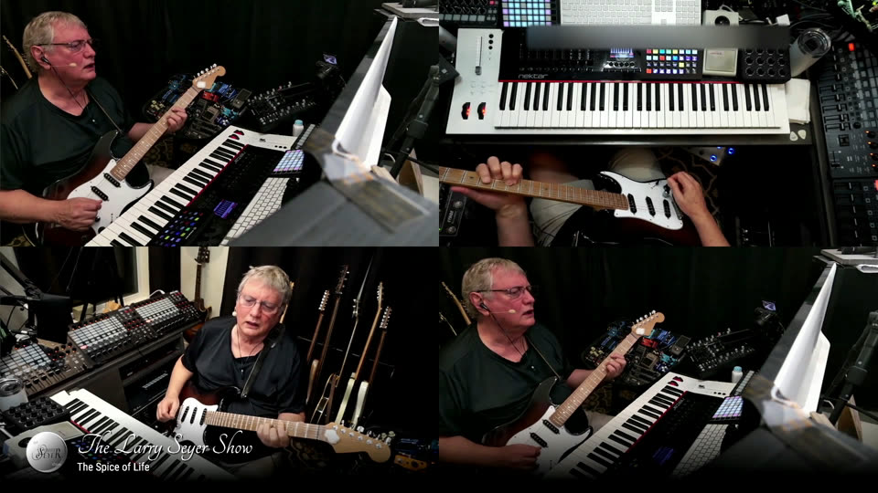

Hides part of the picture, such as an email address, serial number or face, with blur, pixelation or a solid box. Stack several to hide several things. **Goes on:** item or track. Preset name: `LS Tutorial: Blur or Pixelate Region`.

| Control | What it does | Range (default) |
|---|---|---|
| Area left | Hidden area, fractions of the frame (left, top, width, height). | 0 to 1 (0.4) |
| Area top |  | 0 to 1 (0.4) |
| Area width |  | 0.005 to 1 (0.2) |
| Area height |  | 0.005 to 1 (0.1) |
| Mode | Blur, pixelate or a solid box. | Blur, Pixelate, Solid box |
| Strength | Blur or pixel size; 0.6 or more makes text unreadable. | 0 to 1 (0.6) |
| Shape | Rectangle, rounded or ellipse. Use Rectangle for areas that touch the frame edges. | Rectangle, Rounded, Ellipse |
| Edge softness | Edge softness, fraction of frame height. | 0 to 0.1 (0.004) |
| Box color | Color picker. |  |

**Try this:**

- *Hide an email address* - Area left 0.6, Area top 0.05, Area width 0.3, Area height 0.05, Mode Blur, Strength 0.8.

- Stack several instances to hide several things.

### Callout

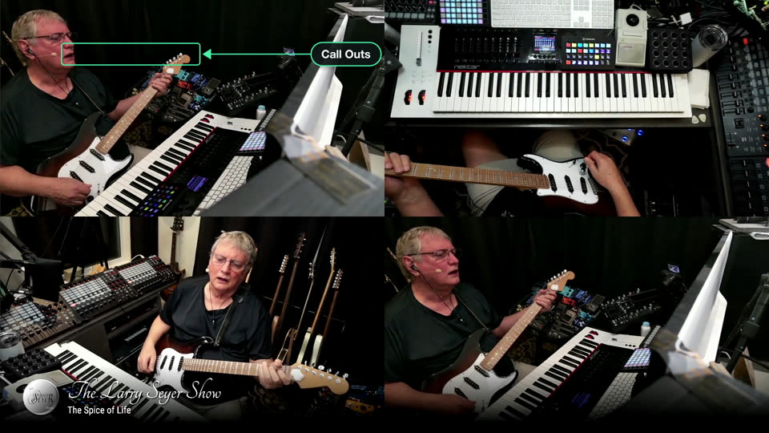

Labels a control in a screen recording: an outlined highlight box, an arrow and a label pill, in the style of the Larry Seyer Drums tutorials. The label text is the item name. Item fades animate it in and out. **Goes on:** item (title item). Preset name: `LS Tutorial: Callout`.

| Control | What it does | Range (default) |
|---|---|---|
| Box left | Highlight box rectangle, fractions of the frame (left, top, width, height). | 0 to 1 (0.08) |
| Box top |  | 0 to 1 (0.1) |
| Box width |  | 0.005 to 1 (0.18) |
| Box height |  | 0.005 to 1 (0.05) |
| Label X | Label pill center X, fraction of frame width. | 0 to 1 (0.45) |
| Label Y | Label pill center Y, fraction of frame height. | 0 to 1 (0.125) |
| Style | Which parts to draw. Numbered badge is a pill sized for a short number. | Box + arrow + label, Arrow + label, Label only, Box only, Numbered badge |
| Text size | Label text height, fraction of frame height. | 0.01 to 0.12 (0.032) |
| Line width | Line width of the box, arrow and pill outline, fraction of frame height. | 0.0005 to 0.01 (0.0028) |
| Box rounding | Box corner rounding (0 square to 1 fully round). | 0 to 1 (0.25) |
| Accent | Color picker. |  |
| Label fill | Color picker. |  |
| Text | Color picker. |  |
| Dim outside box | Darkens everything outside the box. | 0 to 1 (0) |
| Font | Font. | Helvetica Neue, Avenir Next, Futura, Georgia, Gill Sans, Menlo, Impact |
| Animation | Fade, Draw on (the arrow grows toward the target) or Pop. | None, Fade, Draw on, Pop |
| Animate with | Item fades or Manual amount. | Item fades, Manual |
| Manual amount | Manual mode: 0 hidden, 1 shown. | 0 to 1 (1) |

**Try this:**

- *Point at a control* - Box left 0.08, Box top 0.1, Box width 0.18, Box height 0.05, Label X 0.45, Label Y 0.125. Item name: "Call Outs". Place the box over the control and the label beside it.

- Use the panel's + Callout button. The label text is the item name.
- The default colors match the Larry Seyer Drums tutorials (mint outline, dark pill).
- If the item's fades already make a crossfade, set Animate with to Manual and keyframe Manual amount.
- The arrow runs from the label toward the box from any direction, so the label can sit on any side.

### Magnifier

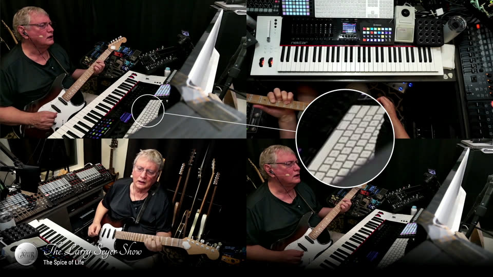

A zoom lens that shows a small detail enlarged somewhere else on screen, with a marker on the original spot and an optional connecting line. Item fades animate it. **Goes on:** item or track. Preset name: `LS Tutorial: Magnifier`.

| Control | What it does | Range (default) |
|---|---|---|
| Detail X | Spot to magnify X, fraction of frame width. | 0 to 1 (0.3) |
| Detail Y | Spot to magnify Y, fraction of frame height. | 0 to 1 (0.3) |
| Lens X | Where the lens appears X. | 0 to 1 (0.7) |
| Lens Y | Where the lens appears Y. | 0 to 1 (0.5) |
| Lens size | Lens diameter, fraction of frame height. | 0.05 to 1 (0.35) |
| Zoom | Magnification. | 1 to 8 (2.5) |
| Shape | Circle or rounded square. | Circle, Rounded square |
| Border width | Border width, fraction of frame height. | 0 to 0.03 (0.004) |
| Border color | Color picker. |  |
| Shadow | Lens shadow. | 0 to 1 (0.5) |
| Mark the detail | Circles the original spot and draws a line to the lens. | off/on (on) |
| Animate with | Item fades or Manual amount. | Item fades, Manual |
| Manual amount | Manual mode: 0 hidden, 1 shown. | 0 to 1 (1) |

**Try this:**

- *Enlarge a small knob* - Detail X 0.3, Detail Y 0.4, Lens X 0.7, Lens Y 0.5, Lens size 0.35, Zoom 3.

- If the item's fades already make a crossfade, set Animate with to Manual and keyframe Manual amount.

### Spotlight

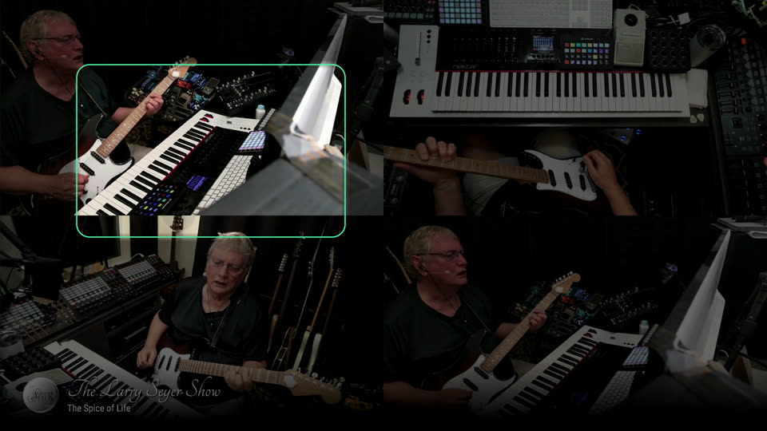

Dims and optionally blurs everything except one area, with an outline around it, to pull attention to a control or part of the screen. Item fades animate it. **Goes on:** item or track. Preset name: `LS Tutorial: Spotlight`.

| Control | What it does | Range (default) |
|---|---|---|
| Area left | Spotlight area, fractions of the frame (left, top, width, height). | 0 to 1 (0.3) |
| Area top |  | 0 to 1 (0.3) |
| Area width |  | 0.01 to 1 (0.4) |
| Area height |  | 0.01 to 1 (0.3) |
| Shape | Rectangle, rounded or ellipse. | Rectangle, Rounded, Ellipse |
| Rounding | Rounding for the Rounded shape. | 0 to 1 (0.15) |
| Edge softness | Edge softness, fraction of frame height. | 0 to 0.2 (0.01) |
| Dim outside | Darkness outside the area. | 0 to 1 (0.6) |
| Blur outside | Blur outside the area (slower at 4K). | 0 to 1 (0) |
| Outline width | Outline width, fraction of frame height (0 = none). | 0 to 0.02 (0.003) |
| Outline color | Color picker. |  |
| Animate with | Item fades or Manual amount. | Item fades, Manual |
| Manual amount | Manual mode: 0 off, 1 full. | 0 to 1 (1) |

**Try this:**

- *Focus on one panel* - Area left 0.1, Area top 0.15, Area width 0.35, Area height 0.4, Shape Rounded, Dim outside 0.6.

- If the item's fades already make a crossfade, set Animate with to Manual and keyframe Manual amount.

## Compose

### Blend Modes

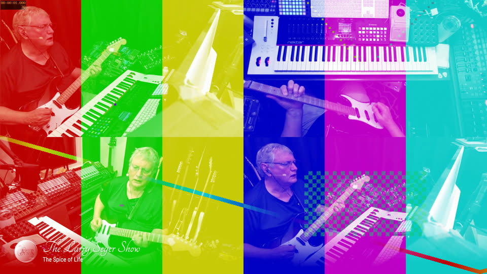

Blends this layer over the tracks behind it like a photo editor layer: multiply, screen, overlay, soft light, add, subtract, difference, lighten, darken and color dodge. **Goes on:** item or track. Preset name: `LS Compose: Blend Modes`.

| Control | What it does | Range (default) |
|---|---|---|
| Blend mode | How this layer combines with the tracks behind it. | Normal, Multiply, Screen, Overlay, Soft light, Add, Subtract, Difference, Lighten, Darken, Color dodge |
| Opacity | Layer opacity. | 0 to 1 (1) |

**Try this:**

- *Light leak overlay* - Blend mode Screen, Opacity 0.8. Put on a track holding a light-leak clip, above the footage.

- Put this on the track in front; it blends that track's video over everything behind it.

### Green Screen Key

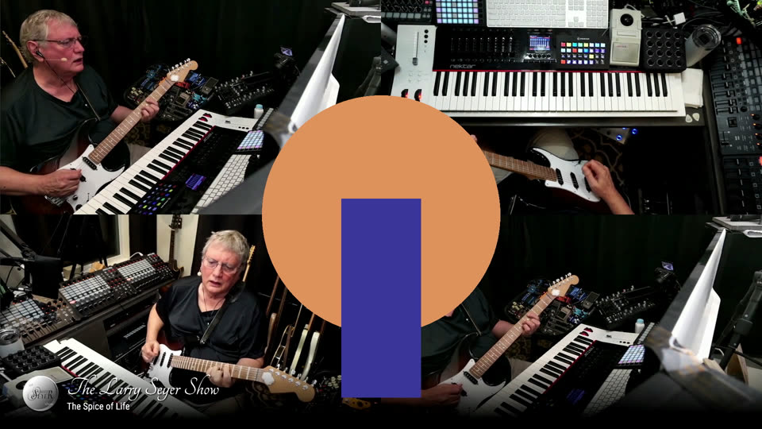

Removes a green or blue backdrop (or any picked color) and puts this clip over the tracks behind it, with spill suppression, edge control and a garbage matte crop. **Goes on:** item or track. Preset name: `LS Compose: Green Screen Key`.

| Control | What it does | Range (default) |
|---|---|---|
| Key color | Backdrop color to remove. | Green, Blue, Custom hue |
| Custom hue | Custom hue in degrees (used with Custom hue). | 0 to 360 (120) |
| Tolerance | Raise if backdrop color remains; lower if the subject gets holes. | 0 to 1 (0.12) |
| Softness | Edge softness of the key. | 0.005 to 1 (0.12) |
| Edge choke | Above 1 tightens edges. | 0.25 to 4 (1) |
| Spill removal | Removes backdrop color reflected on the subject. | 0 to 1 (0.7) |
| Crop left | Garbage matte: crop away parts outside the backdrop. | 0 to 0.5 (0) |
| Crop right |  | 0 to 0.5 (0) |
| Crop top |  | 0 to 0.5 (0) |
| Crop bottom |  | 0 to 0.5 (0) |
| Show matte | Shows the key as black and white. Turn off before rendering. | off/on (off) |

**Try this:**

- *Standard green screen* - Key color Green. Put on the green-screen clip on a track in front of the new background.

### Split Screen

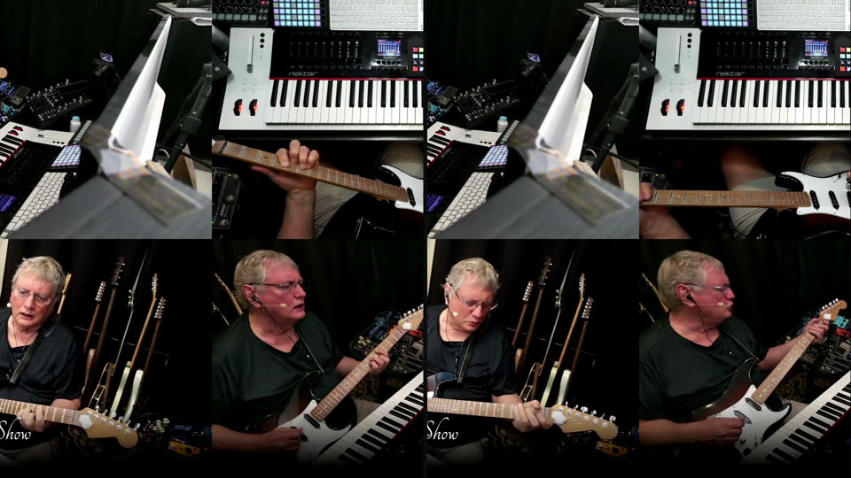

Arranges this track and the tracks behind it side by side, stacked, one large with two small, a 2x2 grid or three columns, with gaps, rounded corners and per-panel framing. **Goes on:** track. Preset name: `LS Compose: Split Screen`.

| Control | What it does | Range (default) |
|---|---|---|
| Layout | Panel arrangement. | Side by side, Stacked, One large + two small, 2x2 grid, Three columns |
| Split position | Where two-panel layouts divide. | 0.2 to 0.8 (0.5) |
| Gap | Gap between panels, fraction of frame height. | 0 to 0.05 (0.008) |
| Outer margin | Outer margin, fraction of frame height. | 0 to 0.1 (0) |
| Corner radius | Panel corner rounding. | 0 to 0.2 (0) |
| Gap color | Color picker. |  |
| Panel 1 pan | Which part of the source shows in its panel, -1..1 (along the cropped direction). | -1 to 1 (0) |
| Panel 2 pan |  | -1 to 1 (0) |
| Panel 3 pan |  | -1 to 1 (0) |
| Panel 4 pan |  | -1 to 1 (0) |
| Zoom | Zoom inside every panel. | 1 to 3 (1) |

**Try this:**

- *Two cameras side by side* - Layout Side by side, Gap 0.008. Put on the front video track; the track directly behind it supplies panel 2.

- Panel 1 is this track; panels 2-4 are the next tracks behind it that have video.

## Time

### Freeze & Stutter

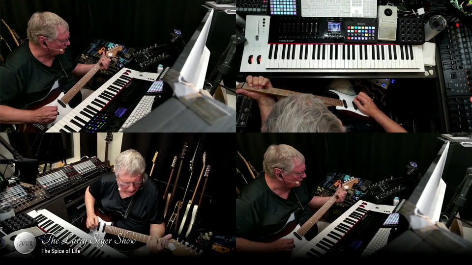

Freeze holds the picture from the moment it switches on (automate it for freeze frames). Stutter holds every frame for several frames for a choppy, stop-motion feel. **Goes on:** item or track. Preset name: `LS Time: Freeze & Stutter`.

| Control | What it does | Range (default) |
|---|---|---|
| Freeze | Turn on (keyframe it) to hold the current picture. | off/on (off) |
| Stutter (hold frames) | Holds each frame for this many frames (1 = off). | 1 to 30 (1) |

**Try this:**

- *Freeze frame* - Freeze 1. Keyframe Freeze from 0 to 1 at the moment to hold, and back to 0 to release.
